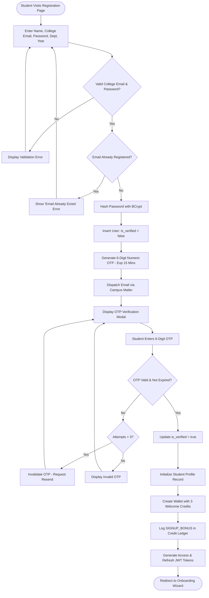
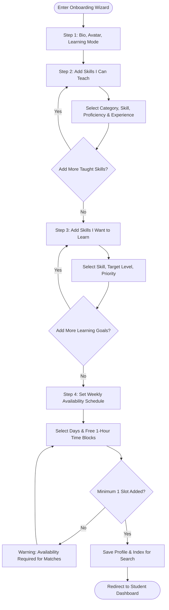
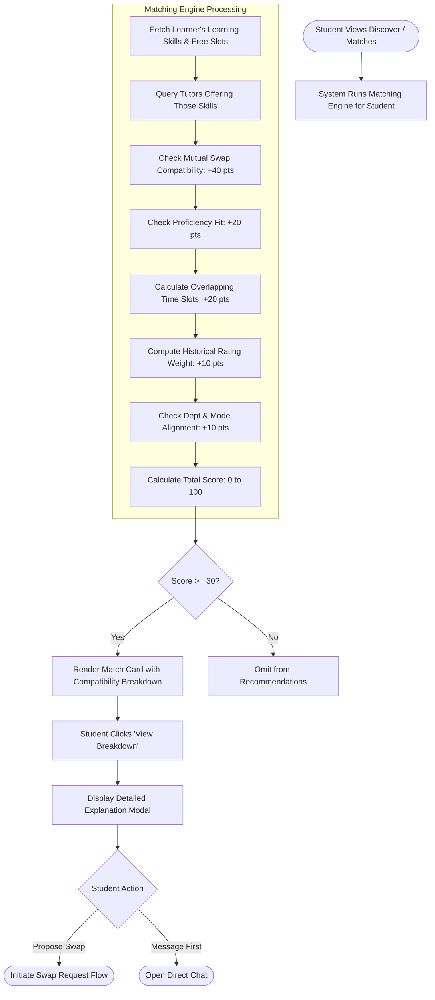
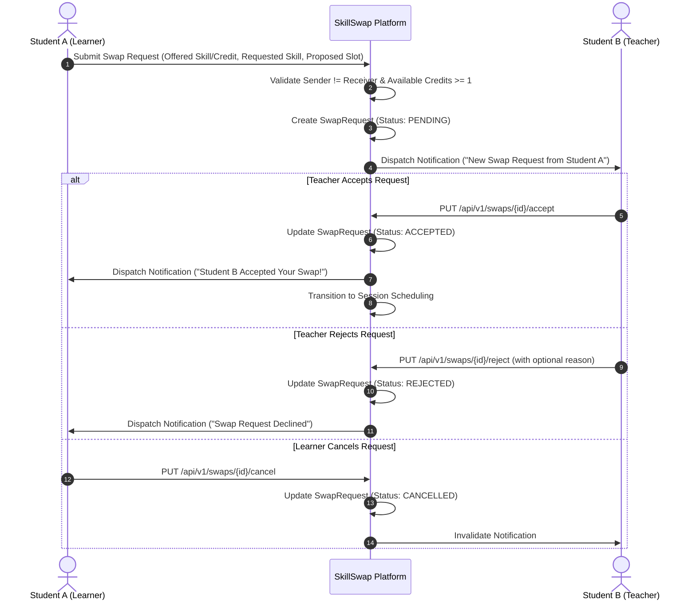
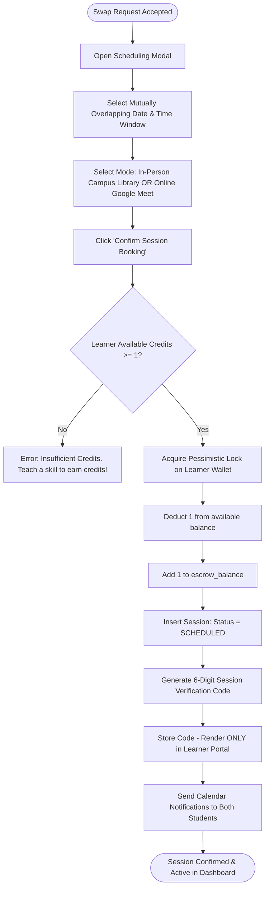
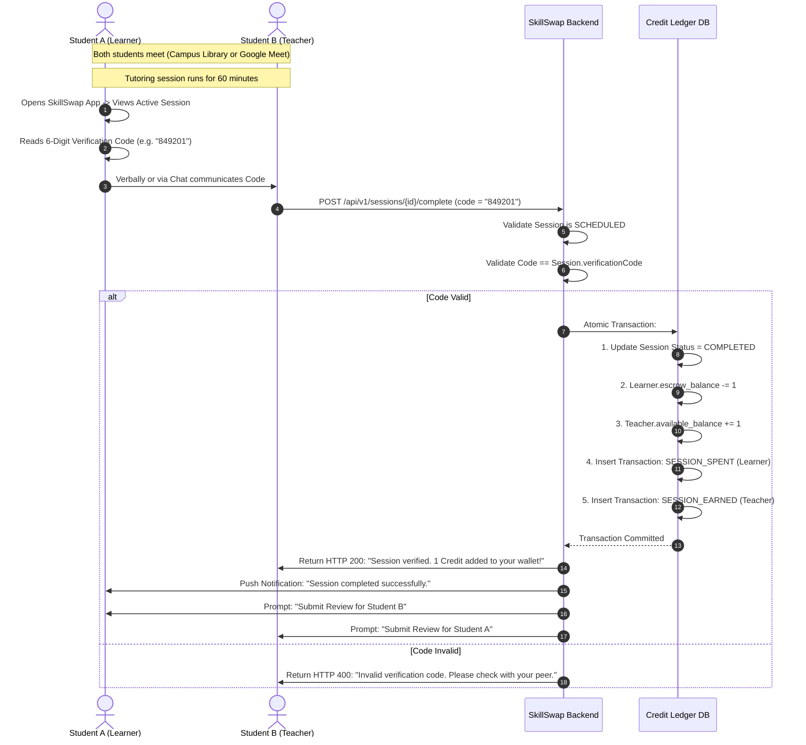
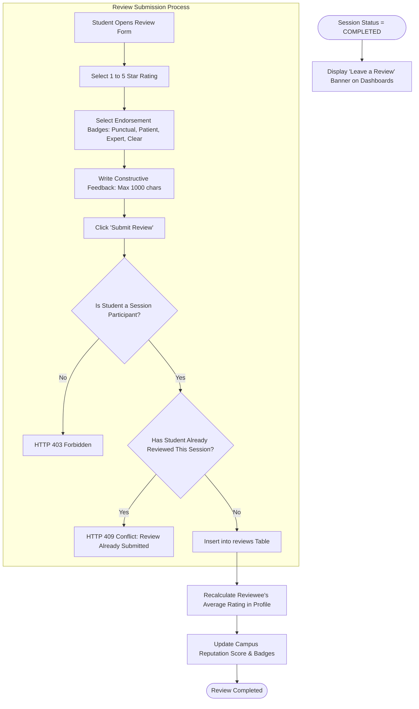
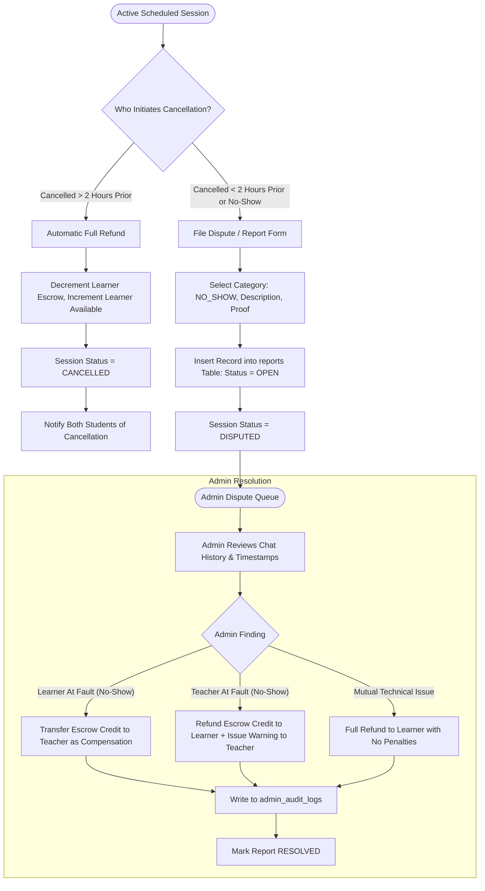
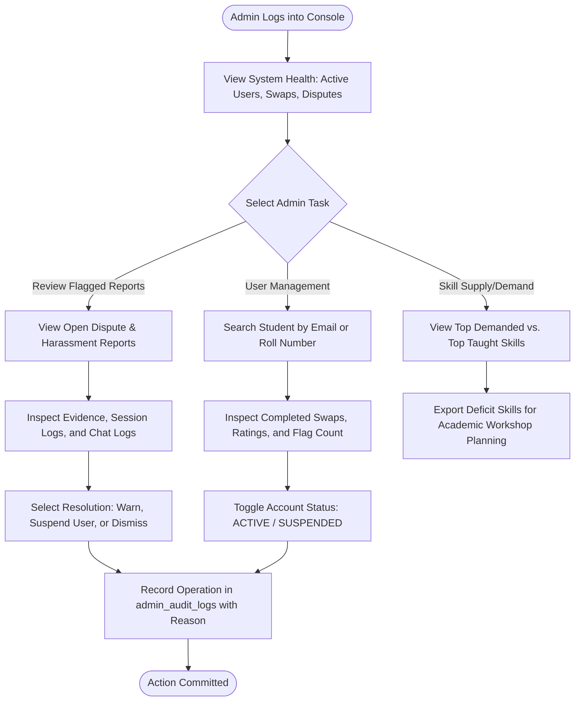

# SkillSwap — Comprehensive User Flows

```
==========================================================================
Document ID      : UFLOW-SKILLSWAP-V1
Scope            : Visual User Flows & System Interaction Diagrams
Standard         : Mermaid Diagramming & State Transition Specifications
==========================================================================
```

This document maps the sequential user journeys across the SkillSwap platform using Mermaid flowcharts and sequence diagrams.

---

## 1. Student Registration & College Email Verification Flow



---

## 2. Onboarding & Skill Profile Setup Flow



---

## 3. Student Discovery & Matching Engine Flow



---

## 4. Swap Request Negotiation Lifecycle



---

## 5. Session Scheduling & Escrow Hold Flow



---

## 6. Session Completion, Verification & Credit Settlement Flow



---

## 7. Dual Post-Session Review & Rating Flow



---

## 8. Cancellation & Dispute Resolution Flow



---

## 9. Administrator Moderation Flow


