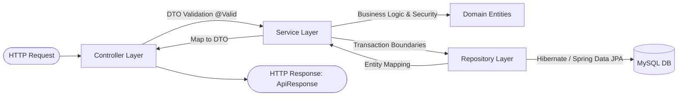
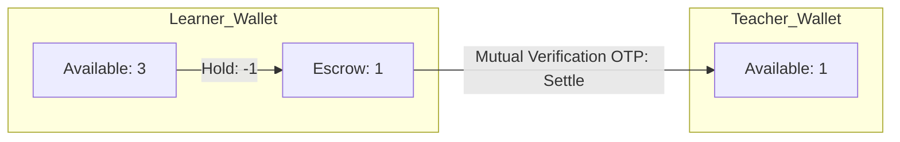

# SkillSwap — System Architecture Specification

```
==========================================================================
Document ID      : ARCH-SKILLSWAP-V1
Scope            : High-Level & Component-Level Software Architecture
Architectural Style: Decoupled Multi-Tier Client-Server Architecture
Target Stack     : React 18 (Vite) + Spring Boot 3 + MySQL 8.0
==========================================================================
```

This document details the architectural topology, component boundaries, data flow pipelines, and technical layers comprising the SkillSwap platform.

---

## 1. High-Level Architectural Pattern

SkillSwap employs a modern, decoupled **3-Tier Architecture**:
1. **Client Tier (Presentation)**: A single-page application (SPA) built with React 18, Vite, and Tailwind CSS running client-side in modern web browsers.
2. **Application Tier (Business Logic)**: A monolithic RESTful API backend developed using Java 25 LTS and Spring Boot 3.5.x, structured in layered enterprise modules.
3. **Data Tier (Persistence)**: An ACID-compliant relational database engine (MySQL 8.0) utilizing InnoDB for row-level locking, foreign key integrity, and transactional guarantees.

```mermaid
flowchart TB
    subgraph Client_Tier [Client Tier: Browser / Single Page Application]
        UI[React 18 SPA + Tailwind CSS]
        Router[React Router v6]
        State[Context API / Custom Hooks]
        AxiosClient[Axios HTTP Client + Interceptors]
    end

    subgraph Security_Perimeter [Security & Gateway Perimeter]
        CORS[CORS Filter]
        RateLimiter[Bucket4j / Filter Rate Limiting]
        JWTFilter[JwtAuthenticationFilter]
    end

    subgraph Backend_Tier [Application Tier: Spring Boot 3 Monolith]
        subgraph Controllers [REST Controllers]
            AuthController[AuthController]
            ProfileController[ProfileController]
            MatchController[MatchController]
            SwapController[SwapController]
            SessionController[SessionController]
            WalletController[WalletController]
            ReviewController[ReviewController]
            ChatController[ChatController]
            AdminController[AdminController]
        end

        subgraph Services [Service Layer - Business Logic]
            AuthService[AuthService]
            ProfileService[ProfileService]
            MatchingEngine[MatchingEngineService]
            SwapService[SwapService]
            SessionService[SessionLifecycleService]
            WalletService[CreditWalletService]
            ReviewService[ReviewService]
            ChatService[ChatService]
            AdminService[AdminService]
        end

        subgraph Repositories [Spring Data JPA Repositories]
            UserRepo[UserRepository]
            ProfileRepo[ProfileRepository]
            SkillRepo[SkillRepository]
            SwapRepo[SwapRequestRepository]
            SessionRepo[SessionRepository]
            WalletRepo[CreditWalletRepository]
            TxnRepo[CreditTxnRepository]
            ReviewRepo[ReviewRepository]
        end
    end

    subgraph Data_Tier [Data Tier: MySQL 8.0]
        MySQL[(MySQL 8.0 InnoDB Database)]
    end

    UI --> Router
    Router --> State
    State --> AxiosClient
    AxiosClient -->|HTTPS REST JSON| CORS
    CORS --> RateLimiter
    RateLimiter --> JWTFilter
    JWTFilter --> Controllers
    Controllers --> Services
    Services --> Repositories
    Repositories -->|JDBC / Hibernate ORM| MySQL
```



---

## 2. Layered Backend Architecture (Spring Boot 3)

The backend follows clean layered architecture principles, ensuring strict separation of concerns, testability, and maintainability.



### 2.1 Layer Responsibilities

1. **Controller Layer (`com.skillswap.controller`)**:
   - Exposes RESTful HTTP endpoints (`@RestController`, `@RequestMapping`).
   - Receives JSON request bodies and maps them to Data Transfer Objects (DTOs).
   - Enforces preliminary validation constraints using `jakarta.validation` annotations (`@Valid`, `@NotNull`, `@Size`, `@Email`).
   - Delegates business logic execution strictly to the Service layer; contains zero business logic.
   - Wraps outgoing responses in a standardized envelope `ApiResponse<T>`.

2. **DTO Layer (`com.skillswap.dto`)**:
   - Request DTOs (e.g., `RegisterRequestDto`, `CreateSwapRequestDto`, `CompleteSessionDto`).
   - Response DTOs (e.g., `StudentSummaryDto`, `MatchScoreDto`, `WalletSummaryDto`).
   - Prevents domain entity leakage, avoiding infinite Jackson recursion in bidirectional JPA relationships and shielding sensitive columns (like password hashes).

3. **Service Layer (`com.skillswap.service`)**:
   - Encapsulates domain logic, algorithmic calculations, and state machine transitions.
   - Governs database transaction boundaries with `@Transactional(isolation = Isolation.READ_COMMITTED)`.
   - Executes pessimistic row locking on wallets (`SELECT ... FOR UPDATE`) during session creation and credit settlement.
   - Throws domain-specific business exceptions (e.g., `InsufficientCreditsException`, `SelfSwapNotAllowedException`).

4. **Repository Layer (`com.skillswap.repository`)**:
   - Extends `JpaRepository<T, ID>` and `JpaSpecificationExecutor<T>`.
   - Defines custom derived queries and native JPQL queries.
   - Utilizes `@Lock(LockModeType.PESSIMISTIC_WRITE)` for concurrency-sensitive wallet records.

5. **Entity Layer (`com.skillswap.entity`)**:
   - JPA-annotated domain models mapped to relational MySQL tables.
   - Manages relational associations (`@OneToMany`, `@ManyToOne`, `@JoinColumn`).
   - Includes auditing metadata (`@CreatedDate`, `@LastModifiedDate`).

6. **Cross-Cutting Concerns**:
   - **Global Exception Handler (`@RestControllerAdvice`)**: Catches validation errors, unauthorized access, and domain exceptions, returning clean, consistent error responses.
   - **Security Filter Chain**: Validates Bearer tokens, establishes `SecurityContextHolder`, and enforces RBAC.

---

## 3. Frontend Architecture (React + Vite)

```mermaid
flowchart TD
    subgraph Presentation [React Presentation Architecture]
        App[App.jsx - Router & Providers]
        
        subgraph Providers [Context Providers]
            AuthProvider[AuthContext: User, Token, Roles]
            ToastProvider[ToastContext: Flash Notifications]
        end
        
        subgraph Guards [Routing Guards]
            PublicRoute[Public / Guest Route]
            PrivateRoute[Protected Student Route]
            AdminRoute[Protected Admin Route]
        end
        
        subgraph Views [Page Modules]
            LandingPage[Landing & Auth Pages]
            OnboardingPage[Onboarding Wizard]
            DashboardPage[Student Dashboard]
            DiscoverPage[Discover & Matches]
            SessionPage[Session & Scheduling]
            WalletPage[Wallet & Transactions]
            AdminConsole[Admin Dashboard]
        end
        
        subgraph Networking [API Layer]
            AxiosInstance[Axios Base Instance: baseURL, timeout]
            ReqInterceptor[Request Interceptor: Inject Bearer JWT]
            ResInterceptor[Response Interceptor: Handle 401 & Refresh Token]
        end
    end

    App --> Providers
    Providers --> Guards
    Guards --> Views
    Views --> Networking
```



### 3.1 Key Client-Side Principles
- **Predictable State Flow**: Global authentication state and active user data are stored within `AuthContext`, while transient UI state (filters, form inputs, modal toggles) resides in local React hooks (`useState`, `useReducer`).
- **Axios HTTP Interceptors**:
  - *Request Interceptor*: Automatically inspects local storage for active `accessToken` and injects `Authorization: Bearer <token>` on all outgoing calls.
  - *Response Interceptor*: Detects HTTP 401 responses, triggers a transparent refresh token rotation call (`/api/v1/auth/refresh-token`), re-attempts the original failed request, or redirects to `/login` if the session has fully expired.
- **Component Modularity**: Design is organized into atomic reusable components (`Button`, `Badge`, `Modal`, `RatingStars`, `ProgressBar`) and composite domain widgets (`MatchCard`, `SessionCountdown`, `WalletBalanceCard`).

---

## 4. Cross-Cutting Architectural Patterns

### 4.1 Credit Escrow & Financial Ledger Pattern
To ensure credits are never created out of thin air, destroyed, or double-spent:
- Wallets are treated as real-time accounts with two balances: `available_balance` and `escrow_balance`.
- Any session reservation atomically moves credit from `available_balance` to `escrow_balance`.
- The completion verification event atomically moves credit from learner's `escrow_balance` to teacher's `available_balance`.
- Every movement generates an immutable record in `credit_transactions`, ensuring complete auditability.



### 4.2 Deterministic Matching Pipeline
Rather than relying on opaque AI models that are difficult to explain, SkillSwap uses a 5-phase deterministic calculation pipeline:
1. **Candidate Retrieval Filter**: Filters active students matching opposite teach/learn pairs.
2. **Vector Scoring Evaluator**: Computes sub-scores for Mutual Match (40%), Skill Level (20%), Availability Overlap (20%), Rating (10%), and Mode/Department Alignment (10%).
3. **Threshold Gate**: Eliminates candidate pairings scoring under 30 points.
4. **Rank & Normalization**: Sorts candidates descending by composite score.
5. **Explanation Serializer**: Bundles human-readable breakdown details into the DTO for front-end rendering.
