# SkillSwap — Relational Database Design Specification

```
==========================================================================
Document ID      : DBD-SKILLSWAP-V1
Target DBMS      : MySQL 8.0 (InnoDB Engine)
Normalization    : Third Normal Form (3NF) compliant
Character Set    : utf8mb4 (Collation: utf8mb4_unicode_ci)
==========================================================================
```

This document specifies the complete relational schema for SkillSwap, including entity structures, constraints, indexes, relationships, and a comprehensive Mermaid Entity-Relationship (ER) diagram.

---

## 1. Mermaid Entity-Relationship (ER) Diagram

```mermaid
erDiagram
    USERS ||--|| STUDENT_PROFILES : "has"
    USERS ||--|| CREDIT_WALLETS : "owns"
    USERS ||--o{ USER_TEACH_SKILLS : "can teach"
    USERS ||--o{ USER_LEARN_SKILLS : "wants to learn"
    USERS ||--o{ AVAILABILITIES : "has schedule"
    USERS ||--o{ SWAP_REQUESTS : "initiates/receives"
    USERS ||--o{ SESSIONS : "attends as learner/teacher"
    USERS ||--o{ REVIEWS : "writes/receives"
    USERS ||--o{ NOTIFICATIONS : "receives"
    USERS ||--o{ USER_BADGES : "earns"
    USERS ||--o{ REPORTS : "files/reported in"
    USERS ||--o{ ADMIN_AUDIT_LOGS : "performs (if admin)"

    SKILL_CATEGORIES ||--o{ SKILLS : "categorizes"
    SKILLS ||--o{ USER_TEACH_SKILLS : "referenced in"
    SKILLS ||--o{ USER_LEARN_SKILLS : "referenced in"
    SKILLS ||--o{ SWAP_REQUESTS : "exchanged in"
    SKILLS ||--o{ SESSIONS : "taught in"

    DEPARTMENTS ||--o{ STUDENT_PROFILES : "belongs to"

    CREDIT_WALLETS ||--o{ CREDIT_TRANSACTIONS : "records ledger for"
    SESSIONS ||--o{ CREDIT_TRANSACTIONS : "triggers"
    SESSIONS ||--o{ REVIEWS : "produces"
    SESSIONS ||--|| SESSION_VERIFICATION_CODES : "secured by"

    CONVERSATIONS ||--o{ CONVERSATION_PARTICIPANTS : "contains"
    USERS ||--o{ CONVERSATION_PARTICIPANTS : "participates in"
    CONVERSATIONS ||--o{ MESSAGES : "contains"
    USERS ||--o{ MESSAGES : "sends"

    BADGES ||--o{ USER_BADGES : "assigned in"

    USERS {
        bigint id PK
        varchar email UK
        varchar password_hash
        varchar full_name
        enum role
        boolean is_verified
        boolean is_active
        timestamp created_at
        timestamp updated_at
    }

    STUDENT_PROFILES {
        bigint id PK
        bigint user_id FK,UK
        bigint department_id FK
        int graduation_year
        text bio
        varchar avatar_url
        varchar portfolio_url
        enum preferred_learning_mode
        decimal average_rating
        int total_reviews_count
        int total_sessions_completed
        timestamp created_at
        timestamp updated_at
    }

    SKILL_CATEGORIES {
        bigint id PK
        varchar name UK
        text description
        varchar icon_name
        boolean is_active
    }

    SKILLS {
        bigint id PK
        bigint category_id FK
        varchar name UK
        text description
        boolean is_approved
        timestamp created_at
    }

    USER_TEACH_SKILLS {
        bigint id PK
        bigint user_id FK
        bigint skill_id FK
        enum proficiency_level
        int experience_months
        text proof_description
        timestamp created_at
    }

    USER_LEARN_SKILLS {
        bigint id PK
        bigint user_id FK
        bigint skill_id FK
        enum target_proficiency_level
        enum priority
        text learning_goal_notes
        timestamp created_at
    }

    AVAILABILITIES {
        bigint id PK
        bigint user_id FK
        enum day_of_week
        time start_time
        time end_time
    }

    SWAP_REQUESTS {
        bigint id PK
        bigint sender_id FK
        bigint receiver_id FK
        bigint offered_skill_id FK
        bigint requested_skill_id FK
        enum status
        enum proposed_mode
        text message
        timestamp expires_at
        timestamp created_at
        timestamp updated_at
    }

    SESSIONS {
        bigint id PK
        bigint swap_request_id FK,UK
        bigint learner_id FK
        bigint teacher_id FK
        bigint skill_id FK
        date scheduled_date
        time start_time
        time end_time
        int duration_minutes
        enum mode
        varchar venue_or_link
        enum status
        timestamp scheduled_at
        timestamp completed_at
    }

    SESSION_VERIFICATION_CODES {
        bigint id PK
        bigint session_id FK,UK
        varchar code_hash
        int attempt_count
        timestamp expires_at
    }

    CREDIT_WALLETS {
        bigint id PK
        bigint user_id FK,UK
        int balance
        int escrow_balance
        int lifetime_earned
        int lifetime_spent
        bigint version
        timestamp updated_at
    }

    CREDIT_TRANSACTIONS {
        bigint id PK
        bigint wallet_id FK
        bigint reference_session_id FK
        enum transaction_type
        int amount
        int balance_after
        varchar description
        timestamp created_at
    }

    REVIEWS {
        bigint id PK
        bigint session_id FK
        bigint reviewer_id FK
        bigint reviewee_id FK
        int rating
        text feedback
        json endorsement_tags
        timestamp created_at
    }

    CONVERSATIONS {
        bigint id PK
        bigint swap_request_id FK
        timestamp created_at
        timestamp updated_at
    }

    MESSAGES {
        bigint id PK
        bigint conversation_id FK
        bigint sender_id FK
        text content
        boolean is_read
        timestamp created_at
    }

    NOTIFICATIONS {
        bigint id PK
        bigint user_id FK
        enum event_type
        varchar title
        text message
        varchar action_url
        boolean is_read
        timestamp created_at
    }

    REPORTS {
        bigint id PK
        bigint reporter_id FK
        bigint reported_user_id FK
        bigint related_session_id FK
        enum category
        text description
        enum status
        text admin_notes
        timestamp created_at
        timestamp updated_at
    }

    ADMIN_AUDIT_LOGS {
        bigint id PK
        bigint admin_user_id FK
        enum action_type
        varchar target_entity
        bigint target_id
        text action_details
        varchar ip_address
        timestamp created_at
    }
```



---

## 2. Table Specifications

### 2.1 Table: `users`
- **Purpose**: Core identity and authentication credentials table.
- **Columns**:
  - `id` (BIGINT, Auto-Increment, Primary Key)
  - `email` (VARCHAR(150), NOT NULL, Unique) — Campus email.
  - `password_hash` (VARCHAR(255), NOT NULL) — BCrypt hash.
  - `full_name` (VARCHAR(100), NOT NULL) — Student's registered name.
  - `role` (ENUM('ROLE_STUDENT', 'ROLE_ADMIN'), NOT NULL, Default: 'ROLE_STUDENT')
  - `is_verified` (BOOLEAN, NOT NULL, Default: FALSE) — Email OTP verification flag.
  - `is_active` (BOOLEAN, NOT NULL, Default: TRUE) — Account moderation status.
  - `created_at` (TIMESTAMP, NOT NULL, Default: CURRENT_TIMESTAMP)
  - `updated_at` (TIMESTAMP, NOT NULL, Default: CURRENT_TIMESTAMP ON UPDATE CURRENT_TIMESTAMP)
- **Constraints & Indexes**:
  - Primary Key: `id`
  - Unique Index: `idx_users_email` ON (`email`)
  - Index: `idx_users_role_active` ON (`role`, `is_active`)

### 2.2 Table: `departments`
- **Purpose**: College faculties and academic departments.
- **Columns**:
  - `id` (BIGINT, Auto-Increment, Primary Key)
  - `code` (VARCHAR(20), NOT NULL, Unique) — e.g., "CSE", "MECH", "DES", "BUS".
  - `name` (VARCHAR(100), NOT NULL) — Full name of department.

### 2.3 Table: `student_profiles`
- **Purpose**: Academic details, biography, and reputation metrics.
- **Columns**:
  - `id` (BIGINT, Auto-Increment, Primary Key)
  - `user_id` (BIGINT, NOT NULL, Unique, FK -> `users.id` ON DELETE CASCADE)
  - `department_id` (BIGINT, NOT NULL, FK -> `departments.id`)
  - `graduation_year` (INT, NOT NULL) — Expected graduation year (e.g., 2026).
  - `bio` (TEXT, NULL) — Up to 500 characters personal intro.
  - `avatar_url` (VARCHAR(255), NULL) — Selected avatar icon or hosted image URL.
  - `portfolio_url` (VARCHAR(255), NULL) — Optional GitHub, Behance, or LinkedIn link.
  - `preferred_learning_mode` (ENUM('IN_PERSON', 'ONLINE', 'HYBRID'), NOT NULL, Default: 'HYBRID')
  - `average_rating` (DECIMAL(3, 2), NOT NULL, Default: 0.00) — Running average (0.00 to 5.00).
  - `total_reviews_count` (INT, NOT NULL, Default: 0)
  - `total_sessions_completed` (INT, NOT NULL, Default: 0)
  - `created_at` (TIMESTAMP, NOT NULL, Default: CURRENT_TIMESTAMP)
  - `updated_at` (TIMESTAMP, NOT NULL, Default: CURRENT_TIMESTAMP ON UPDATE CURRENT_TIMESTAMP)
- **Constraints & Indexes**:
  - Primary Key: `id`
  - Unique Key: `user_id`
  - Index: `idx_profiles_dept_rating` ON (`department_id`, `average_rating`)

### 2.4 Table: `skill_categories`
- **Purpose**: Classification taxonomy for skills.
- **Columns**:
  - `id` (BIGINT, Auto-Increment, Primary Key)
  - `name` (VARCHAR(50), NOT NULL, Unique) — e.g., "Programming & Tech", "Design & Creative".
  - `description` (TEXT, NULL)
  - `icon_name` (VARCHAR(50), NULL) — Lucide icon identifier.
  - `is_active` (BOOLEAN, NOT NULL, Default: TRUE)

### 2.5 Table: `skills`
- **Purpose**: Master catalog of skills available on campus.
- **Columns**:
  - `id` (BIGINT, Auto-Increment, Primary Key)
  - `category_id` (BIGINT, NOT NULL, FK -> `skill_categories.id`)
  - `name` (VARCHAR(100), NOT NULL, Unique) — e.g., "Java", "React", "Figma", "Public Speaking".
  - `description` (TEXT, NULL)
  - `is_approved` (BOOLEAN, NOT NULL, Default: TRUE)
  - `created_at` (TIMESTAMP, NOT NULL, Default: CURRENT_TIMESTAMP)
- **Constraints & Indexes**:
  - Unique Index: `idx_skills_name` ON (`name`)
  - Index: `idx_skills_category` ON (`category_id`)

### 2.6 Table: `user_teach_skills`
- **Purpose**: Skills a student can tutor.
- **Columns**:
  - `id` (BIGINT, Auto-Increment, Primary Key)
  - `user_id` (BIGINT, NOT NULL, FK -> `users.id` ON DELETE CASCADE)
  - `skill_id` (BIGINT, NOT NULL, FK -> `skills.id`)
  - `proficiency_level` (ENUM('BEGINNER', 'INTERMEDIATE', 'ADVANCED', 'EXPERT'), NOT NULL)
  - `experience_months` (INT, NOT NULL, Default: 0)
  - `proof_description` (TEXT, NULL) — Brief notes on relevant projects or coursework.
  - `created_at` (TIMESTAMP, NOT NULL, Default: CURRENT_TIMESTAMP)
- **Constraints & Indexes**:
  - Unique Constraint: `uk_user_teach_skill` ON (`user_id`, `skill_id`)
  - Index: `idx_teach_skill_proficiency` ON (`skill_id`, `proficiency_level`)

### 2.7 Table: `user_learn_skills`
- **Purpose**: Skills a student desires to learn.
- **Columns**:
  - `id` (BIGINT, Auto-Increment, Primary Key)
  - `user_id` (BIGINT, NOT NULL, FK -> `users.id` ON DELETE CASCADE)
  - `skill_id` (BIGINT, NOT NULL, FK -> `skills.id`)
  - `target_proficiency_level` (ENUM('BEGINNER', 'INTERMEDIATE', 'ADVANCED', 'EXPERT'), NOT NULL)
  - `priority` (ENUM('LOW', 'MEDIUM', 'HIGH'), NOT NULL, Default: 'MEDIUM')
  - `learning_goal_notes` (TEXT, NULL)
  - `created_at` (TIMESTAMP, NOT NULL, Default: CURRENT_TIMESTAMP)
- **Constraints & Indexes**:
  - Unique Constraint: `uk_user_learn_skill` ON (`user_id`, `skill_id`)
  - Index: `idx_learn_skill_priority` ON (`skill_id`, `priority`)

### 2.8 Table: `availabilities`
- **Purpose**: Recurring weekly time windows when students are free for tutoring.
- **Columns**:
  - `id` (BIGINT, Auto-Increment, Primary Key)
  - `user_id` (BIGINT, NOT NULL, FK -> `users.id` ON DELETE CASCADE)
  - `day_of_week` (ENUM('MONDAY', 'TUESDAY', 'WEDNESDAY', 'THURSDAY', 'FRIDAY', 'SATURDAY', 'SUNDAY'), NOT NULL)
  - `start_time` (TIME, NOT NULL)
  - `end_time` (TIME, NOT NULL)
- **Constraints & Indexes**:
  - Index: `idx_availability_user_day` ON (`user_id`, `day_of_week`)
  - Check Constraint: `chk_avail_times` CHECK (`start_time` < `end_time`)

### 2.9 Table: `swap_requests`
- **Purpose**: Formal proposals between two students to exchange skills.
- **Columns**:
  - `id` (BIGINT, Auto-Increment, Primary Key)
  - `sender_id` (BIGINT, NOT NULL, FK -> `users.id`)
  - `receiver_id` (BIGINT, NOT NULL, FK -> `users.id`)
  - `offered_skill_id` (BIGINT, NULL, FK -> `skills.id`) — NULL if pure credit-backed swap.
  - `requested_skill_id` (BIGINT, NOT NULL, FK -> `skills.id`)
  - `status` (ENUM('PENDING', 'ACCEPTED', 'REJECTED', 'CANCELLED', 'EXPIRED'), NOT NULL, Default: 'PENDING')
  - `proposed_mode` (ENUM('IN_PERSON', 'ONLINE'), NOT NULL)
  - `message` (TEXT, NULL)
  - `expires_at` (TIMESTAMP, NOT NULL)
  - `created_at` (TIMESTAMP, NOT NULL, Default: CURRENT_TIMESTAMP)
  - `updated_at` (TIMESTAMP, NOT NULL, Default: CURRENT_TIMESTAMP ON UPDATE CURRENT_TIMESTAMP)
- **Constraints & Indexes**:
  - Check Constraint: `chk_swap_no_self` CHECK (`sender_id` <> `receiver_id`)
  - Index: `idx_swap_sender_status` ON (`sender_id`, `status`)
  - Index: `idx_swap_receiver_status` ON (`receiver_id`, `status`)

### 2.10 Table: `sessions`
- **Purpose**: Scheduled tutoring meetings resulting from an accepted swap request.
- **Columns**:
  - `id` (BIGINT, Auto-Increment, Primary Key)
  - `swap_request_id` (BIGINT, NOT NULL, Unique, FK -> `swap_requests.id`)
  - `learner_id` (BIGINT, NOT NULL, FK -> `users.id`)
  - `teacher_id` (BIGINT, NOT NULL, FK -> `users.id`)
  - `skill_id` (BIGINT, NOT NULL, FK -> `skills.id`)
  - `scheduled_date` (DATE, NOT NULL)
  - `start_time` (TIME, NOT NULL)
  - `end_time` (TIME, NOT NULL)
  - `duration_minutes` (INT, NOT NULL, Default: 60)
  - `mode` (ENUM('IN_PERSON', 'ONLINE'), NOT NULL)
  - `venue_or_link` (VARCHAR(255), NOT NULL) — e.g., "Library Room 302" or "https://meet.google.com/xyz".
  - `status` (ENUM('SCHEDULED', 'IN_PROGRESS', 'COMPLETED', 'CANCELLED', 'DISPUTED'), NOT NULL, Default: 'SCHEDULED')
  - `scheduled_at` (TIMESTAMP, NOT NULL, Default: CURRENT_TIMESTAMP)
  - `completed_at` (TIMESTAMP, NULL)
- **Constraints & Indexes**:
  - Check Constraint: `chk_session_no_self` CHECK (`learner_id` <> `teacher_id`)
  - Index: `idx_sessions_learner_date` ON (`learner_id`, `scheduled_date`, `status`)
  - Index: `idx_sessions_teacher_date` ON (`teacher_id`, `scheduled_date`, `status`)

### 2.11 Table: `session_verification_codes`
- **Purpose**: Cryptographic 6-digit mutual completion tokens.
- **Columns**:
  - `id` (BIGINT, Auto-Increment, Primary Key)
  - `session_id` (BIGINT, NOT NULL, Unique, FK -> `sessions.id` ON DELETE CASCADE)
  - `code_hash` (VARCHAR(255), NOT NULL) — Hashed 6-digit OTP.
  - `attempt_count` (INT, NOT NULL, Default: 0)
  - `expires_at` (TIMESTAMP, NOT NULL)

### 2.12 Table: `credit_wallets`
- **Purpose**: Real-time balance and escrow holds for student accounts.
- **Columns**:
  - `id` (BIGINT, Auto-Increment, Primary Key)
  - `user_id` (BIGINT, NOT NULL, Unique, FK -> `users.id` ON DELETE CASCADE)
  - `balance` (INT, NOT NULL, Default: 0) — Available credits.
  - `escrow_balance` (INT, NOT NULL, Default: 0) — Credits locked in scheduled sessions.
  - `lifetime_earned` (INT, NOT NULL, Default: 0)
  - `lifetime_spent` (INT, NOT NULL, Default: 0)
  - `version` (BIGINT, NOT NULL, Default: 0) — Optimistic locking token.
  - `updated_at` (TIMESTAMP, NOT NULL, Default: CURRENT_TIMESTAMP ON UPDATE CURRENT_TIMESTAMP)
- **Constraints & Indexes**:
  - Check Constraint: `chk_positive_balance` CHECK (`balance` >= 0)
  - Check Constraint: `chk_positive_escrow` CHECK (`escrow_balance` >= 0)

### 2.13 Table: `credit_transactions`
- **Purpose**: Immutable ledger recording all credit inflows, holds, settlements, and refunds.
- **Columns**:
  - `id` (BIGINT, Auto-Increment, Primary Key)
  - `wallet_id` (BIGINT, NOT NULL, FK -> `credit_wallets.id`)
  - `reference_session_id` (BIGINT, NULL, FK -> `sessions.id`)
  - `transaction_type` (ENUM('SIGNUP_BONUS', 'SESSION_SPENT', 'SESSION_EARNED', 'ESCROW_HOLD', 'ESCROW_RELEASE', 'REFUND', 'ADMIN_ADJUSTMENT'), NOT NULL)
  - `amount` (INT, NOT NULL) — e.g., +3, -1, +1.
  - `balance_after` (INT, NOT NULL) — Balance after transaction applied.
  - `description` (VARCHAR(255), NOT NULL)
  - `created_at` (TIMESTAMP, NOT NULL, Default: CURRENT_TIMESTAMP)
- **Constraints & Indexes**:
  - Index: `idx_txns_wallet_created` ON (`wallet_id`, `created_at`)

### 2.14 Table: `reviews`
- **Purpose**: Post-session evaluations and endorsements.
- **Columns**:
  - `id` (BIGINT, Auto-Increment, Primary Key)
  - `session_id` (BIGINT, NOT NULL, FK -> `sessions.id`)
  - `reviewer_id` (BIGINT, NOT NULL, FK -> `users.id`)
  - `reviewee_id` (BIGINT, NOT NULL, FK -> `users.id`)
  - `rating` (INT, NOT NULL) — Must be 1, 2, 3, 4, or 5.
  - `feedback` (TEXT, NULL) — Up to 1000 characters.
  - `endorsement_tags` (JSON, NULL) — e.g., `["Patient", "Clear Explanations"]`.
  - `created_at` (TIMESTAMP, NOT NULL, Default: CURRENT_TIMESTAMP)
- **Constraints & Indexes**:
  - Unique Key: `uk_session_reviewer` ON (`session_id`, `reviewer_id`)
  - Check Constraint: `chk_rating_range` CHECK (`rating` BETWEEN 1 AND 5)
  - Index: `idx_reviews_reviewee` ON (`reviewee_id`, `rating`)

### 2.15 Table: `conversations` & `conversation_participants`
- **Purpose**: 1-on-1 messaging threads tied to accepted swaps or sessions.
- **Columns (`conversations`)**:
  - `id` (BIGINT, Auto-Increment, Primary Key)
  - `swap_request_id` (BIGINT, NOT NULL, FK -> `swap_requests.id`)
  - `created_at` (TIMESTAMP, NOT NULL, Default: CURRENT_TIMESTAMP)
  - `updated_at` (TIMESTAMP, NOT NULL, Default: CURRENT_TIMESTAMP ON UPDATE CURRENT_TIMESTAMP)
- **Columns (`conversation_participants`)**:
  - `conversation_id` (BIGINT, NOT NULL, FK -> `conversations.id`)
  - `user_id` (BIGINT, NOT NULL, FK -> `users.id`)
  - Primary Key: (`conversation_id`, `user_id`)

### 2.16 Table: `messages`
- **Purpose**: Direct chat messages.
- **Columns**:
  - `id` (BIGINT, Auto-Increment, Primary Key)
  - `conversation_id` (BIGINT, NOT NULL, FK -> `conversations.id` ON DELETE CASCADE)
  - `sender_id` (BIGINT, NOT NULL, FK -> `users.id`)
  - `content` (TEXT, NOT NULL)
  - `is_read` (BOOLEAN, NOT NULL, Default: FALSE)
  - `created_at` (TIMESTAMP, NOT NULL, Default: CURRENT_TIMESTAMP)
- **Constraints & Indexes**:
  - Index: `idx_messages_convo_created` ON (`conversation_id`, `created_at`)

### 2.17 Table: `notifications`
- **Purpose**: In-app alerts for system events.
- **Columns**:
  - `id` (BIGINT, Auto-Increment, Primary Key)
  - `user_id` (BIGINT, NOT NULL, FK -> `users.id` ON DELETE CASCADE)
  - `event_type` (ENUM('SWAP_RECEIVED', 'SWAP_ACCEPTED', 'SWAP_REJECTED', 'SESSION_REMINDER', 'SESSION_COMPLETED', 'CREDIT_UPDATE', 'DISPUTE_ALERT'), NOT NULL)
  - `title` (VARCHAR(100), NOT NULL)
  - `message` (TEXT, NOT NULL)
  - `action_url` (VARCHAR(255), NULL)
  - `is_read` (BOOLEAN, NOT NULL, Default: FALSE)
  - `created_at` (TIMESTAMP, NOT NULL, Default: CURRENT_TIMESTAMP)
- **Constraints & Indexes**:
  - Index: `idx_notifs_user_read` ON (`user_id`, `is_read`)

### 2.18 Table: `reports` & `admin_audit_logs`
- **Columns (`reports`)**:
  - `id` (BIGINT, Auto-Increment, Primary Key)
  - `reporter_id` (BIGINT, NOT NULL, FK -> `users.id`)
  - `reported_user_id` (BIGINT, NOT NULL, FK -> `users.id`)
  - `related_session_id` (BIGINT, NULL, FK -> `sessions.id`)
  - `category` (ENUM('NO_SHOW', 'HARASSMENT', 'FRAUD', 'INAPPROPRIATE_CONTENT', 'OTHER'), NOT NULL)
  - `description` (TEXT, NOT NULL)
  - `status` (ENUM('OPEN', 'UNDER_REVIEW', 'RESOLVED', 'DISMISSED'), NOT NULL, Default: 'OPEN')
  - `admin_notes` (TEXT, NULL)
  - `created_at` (TIMESTAMP, NOT NULL, Default: CURRENT_TIMESTAMP)
  - `updated_at` (TIMESTAMP, NOT NULL, Default: CURRENT_TIMESTAMP ON UPDATE CURRENT_TIMESTAMP)
- **Columns (`admin_audit_logs`)**:
  - `id` (BIGINT, Auto-Increment, Primary Key)
  - `admin_user_id` (BIGINT, NOT NULL, FK -> `users.id`)
  - `action_type` (ENUM('SUSPEND_USER', 'ACTIVATE_USER', 'RESOLVE_DISPUTE', 'ADJUST_CREDITS', 'DELETE_REVIEW'), NOT NULL)
  - `target_entity` (VARCHAR(50), NOT NULL)
  - `target_id` (BIGINT, NOT NULL)
  - `action_details` (TEXT, NOT NULL)
  - `ip_address` (VARCHAR(45), NULL)
  - `created_at` (TIMESTAMP, NOT NULL, Default: CURRENT_TIMESTAMP)
