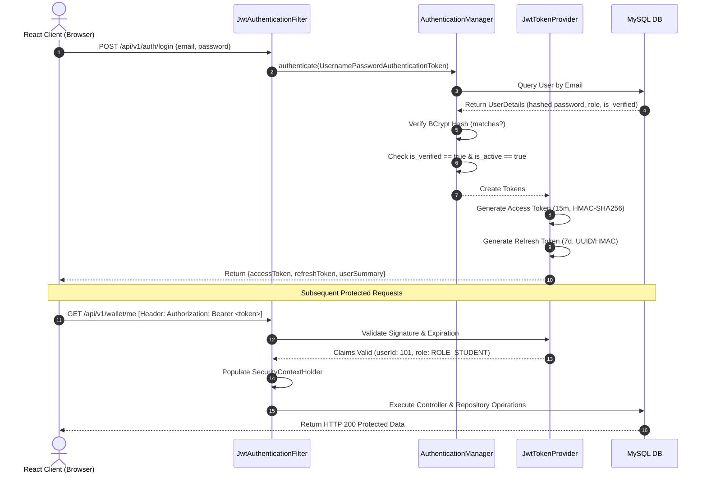

# SkillSwap — Authentication & Security Blueprint

```
==========================================================================
Document ID      : SEC-SKILLSWAP-V1
Compliance Scope : OWASP Top 10 (2021), Campus Privacy Standards
Security Model   : Stateless JWT Authentication + Spring Security 6 RBAC
Password Standard: BCrypt (Strength Factor 12)
==========================================================================
```

This document details the security architecture, authentication mechanics, authorization policies, threat modeling, and defense mechanisms safeguarding the SkillSwap platform.

---

## 1. Authentication Architecture

SkillSwap relies on a stateless, token-based authentication mechanism powered by **Spring Security 6** and **JSON Web Tokens (JWT)**.



---

## 2. Password Cryptography & Credential Storage

### 2.1 BCrypt Hashing
- Under no circumstances are plaintext passwords ever persisted, logged, or serialized.
- Passwords are encrypted using Spring Security's `BCryptPasswordEncoder` with a cost factor (strength) of **12**:
  ```java
  @Bean
  public PasswordEncoder passwordEncoder() {
      return new BCryptPasswordEncoder(12);
  }
  ```
- Each hash generates an internal 128-bit cryptographically secure salt, protecting against pre-computed rainbow table attacks.

### 2.2 Password Complexity Policy
- Minimum length: 8 characters.
- Maximum length: 64 characters (mitigates denial-of-service via long hashing payloads).
- Complexity requirement: At least 1 uppercase letter (`A-Z`), 1 lowercase letter (`a-z`), 1 numerical digit (`0-9`), and 1 special symbol (`@$!%*?&#`).

---

## 3. JSON Web Token (JWT) Lifecycle

### 3.1 Token Characteristics
| Parameter | Access Token | Refresh Token |
| :--- | :--- | :--- |
| **Lifespan** | 15 minutes (Short-lived) | 7 days (Long-lived) |
| **Algorithm** | HMAC-SHA256 (`HS256`) | HMAC-SHA256 (`HS256`) |
| **Secret Key Size** | Minimum 256 bits (32 bytes cryptographically secure) | Stored as hashed secret in DB / memory |
| **Payload Claims** | `sub` (userId), `email`, `role`, `iat`, `exp` | `sub` (userId), `tokenVersion`, `exp` |
| **Client Storage** | In-memory / React AuthContext | Secure `HttpOnly`, `SameSite=Strict` Cookie |

### 3.2 Token Refresh & Replay Protection
When the access token expires (HTTP 401), the React client automatically calls `/api/v1/auth/refresh-token`. If the refresh token is expired or revoked (e.g., after password change or admin suspension), the session is terminated and user redirected to `/login`.

---

## 4. Role-Based Access Control (RBAC)

The system defines two strict roles:
1. `ROLE_STUDENT`: Standard verified college student.
2. `ROLE_ADMIN`: Campus coordinator / platform moderator.

### 4.1 URL Authorization Matrix
```java
@Bean
public SecurityFilterChain securityFilterChain(HttpSecurity http) throws Exception {
    http
        .csrf(csrf -> csrf.disable()) // Stateless JWT API
        .sessionManagement(session -> session.sessionCreationPolicy(SessionCreationPolicy.STATELESS))
        .authorizeHttpRequests(auth -> auth
            // Public endpoints
            .requestMatchers("/api/v1/auth/**").permitAll()
            .requestMatchers(HttpMethod.GET, "/api/v1/skills/**").permitAll()
            
            // Administrator endpoints
            .requestMatchers("/api/v1/admin/**").hasRole("ADMIN")
            
            // Student protected endpoints
            .requestMatchers("/api/v1/profiles/**").hasRole("STUDENT")
            .requestMatchers("/api/v1/swaps/**").hasRole("STUDENT")
            .requestMatchers("/api/v1/sessions/**").hasRole("STUDENT")
            .requestMatchers("/api/v1/wallet/**").hasRole("STUDENT")
            .requestMatchers("/api/v1/matches/**").hasRole("STUDENT")
            
            .anyRequest().authenticated()
        )
        .addFilterBefore(jwtAuthenticationFilter, UsernamePasswordAuthenticationFilter.class);
    return http.build();
}
```

---

## 5. College Email Verification & Sybil Resistance

To prevent spam registrations, fake profiles, and non-student access:
1. **Domain Whitelisting**: Email domain regex enforced during registration:
   `^[A-Za-z0-9._%+-]+@([A-Za-z0-9.-]+\.)?(college\.edu|university\.ac\.in)$`
2. **6-Digit One-Time Password (OTP)**:
   - Generated via `SecureRandom` (cryptographically strong).
   - Valid for exactly 15 minutes.
   - Max 3 verification attempts before requiring OTP regeneration.
3. **No Dual Registration**: Institutional emails are unique in `users.email`.

---

## 6. OWASP Defense Implementations

### 6.1 SQL Injection (SQLi) Defense
- **Rule**: 100% of queries execute through Spring Data JPA repositories with parameterized binding.
- **Rule**: No native queries constructing SQL through string concatenation (`"SELECT * FROM users WHERE email = '" + email + "'"` is strictly forbidden).

### 6.2 Cross-Site Scripting (XSS) Defense
- **Frontend**: React's JSX engine auto-escapes dynamic variables before DOM insertion.
- **Backend Sanitization**: All incoming text fields (bio, feedback, chat messages) are sanitized to strip harmful `<script>`, `<iframe>`, or `javascript:` URI patterns.

### 6.3 Cross-Origin Resource Sharing (CORS)
- Backend CORS configuration explicitly whitelists the frontend development and production origins (e.g., `http://localhost:5173` and `https://skillswap.campus.edu`). Wildcard `*` origins are prohibited when credentials are enabled.

### 6.4 Rate Limiting & Brute-Force Prevention
- Sensitive endpoints (`/api/v1/auth/login`, `/api/v1/auth/register`, `/api/v1/auth/verify-email`) enforce rate limiting:
  - Max 5 requests per IP per minute.
  - Exceeding threshold triggers HTTP 429 Too Many Requests.

### 6.5 Student Privacy & Information Masking (PII Protection)
- Student personal phone numbers, physical hostel addresses, and student roll numbers are **never exposed** over public API endpoints.
- Public search endpoints return only: First Name, Last Initial, Department, Graduation Year, Bio, and Skill Profiles.
- Meeting location/link is only visible to the 2 confirmed participants of a scheduled session.
