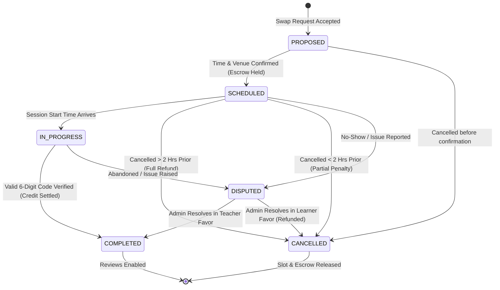

# SkillSwap — Session Lifecycle & State Machine Specification

```
==========================================================================
Document ID      : SESS-SKILLSWAP-V1
Model Type       : Finite State Machine (FSM)
Verification Protocol: Cryptographic 6-Digit Mutual Verification Code (MVC)
Settlement Type  : Atomic Exactly-Once Execution
==========================================================================
```

This document specifies the state transitions, timing rules, OTP verification protocol, dispute escalations, and idempotency guarantees governing tutoring sessions on SkillSwap.

---

## 1. Formal Session Finite State Machine (FSM)



---

## 2. Permitted State Transitions & Invariants

| From State | To State | Trigger / Action | Authorization | Financial Ledger Action |
| :--- | :--- | :--- | :--- | :--- |
| `PROPOSED` | `SCHEDULED` | Both students agree on date, time, and venue/link. | Learner / Teacher | Decrement Learner Available by 1; Increment Learner Escrow by 1. |
| `PROPOSED` | `CANCELLED` | Either party cancels before scheduling. | Learner / Teacher | None. |
| `SCHEDULED` | `CANCELLED` | Cancelled > 2 hours prior to scheduled start. | Learner or Teacher | Decrement Learner Escrow by 1; Increment Learner Available by 1 (Full Refund). |
| `SCHEDULED` | `CANCELLED` | Cancelled < 2 hours prior to start. | Learner or Teacher | Refund 0.5 to Learner; 0.5 to Teacher as late compensation. |
| `SCHEDULED` | `IN_PROGRESS`| Current system time reaches `scheduled_date + start_time`. | System Clock | None. Session marked active. |
| `IN_PROGRESS`| `COMPLETED` | Teacher enters valid 6-digit session verification code. | Teacher | Decrement Learner Escrow by 1; Increment Teacher Available by 1 (Atomic Settlement). |
| `SCHEDULED` / `IN_PROGRESS` | `DISPUTED` | Either party files a dispute (No-show, Harassment). | Learner / Teacher | Credit remains frozen in Escrow pending admin review. |
| `DISPUTED` | `COMPLETED` | Admin arbitrates in favor of Teacher. | Admin | Decrement Learner Escrow by 1; Increment Teacher Available by 1. |
| `DISPUTED` | `CANCELLED` | Admin arbitrates in favor of Learner. | Admin | Decrement Learner Escrow by 1; Increment Learner Available by 1. |

---

## 3. Mutual Verification Code (MVC) Protocol

To guarantee that sessions actually take place before credits are transferred, SkillSwap uses a 6-digit **Mutual Verification Code**:

```
      [ LEARNER'S SCREEN ]                       [ TEACHER'S SCREEN ]
┌────────────────────────────────┐         ┌────────────────────────────────┐
│ Active Session: React Basics   │         │ Active Session: React Basics   │
│ Mentor: Ananya Patel           │         │ Student: Rohan Sharma          │
│                                │         │                                │
│ YOUR VERIFICATION CODE:        │         │ ENTER VERIFICATION CODE:       │
│      [ 8 4 9 2 0 1 ]           │         │ [  ] [  ] [  ] [  ] [  ] [  ]  │
│                                │         │                                │
│ Share this code with your      │         │ [ Verify & Claim 1 Credit ]    │
│ mentor at the end of session.  │         │                                │
└────────────────────────────────┘         └────────────────────────────────┘
                │                                          ▲
                │        Verbally Shared at Meeting        │
                └──────────────────────────────────────────┘
```

### 3.1 Verification Protocol Rules
1. **Asymmetric Access**: The 6-digit numeric code is rendered **only on the learner's dashboard**. The teacher cannot see this code in the database or API responses.
2. **Timing Window**: The teacher can only submit the code during the active session window (from session start time up to 24 hours post-session).
3. **Attempt Throttling**: The teacher has a maximum of **3 attempts** to enter the correct code. If 3 incorrect codes are entered, the session auto-locks into `DISPUTED` status to prevent brute-force guessing.

---

## 4. Exactly-Once Settlement Guarantee

To prevent race conditions or duplicate network calls:

```java
@Service
@Transactional(isolation = Isolation.READ_COMMITTED)
public SessionCompleteResponse completeSession(Long sessionId, String verificationCode, Long teacherId) {
    // 1. Fetch Session with Pessimistic Lock
    Session session = sessionRepository.findByIdWithLock(sessionId)
        .orElseThrow(() -> new SessionNotFoundException(sessionId));

    // 2. Strict State Guard
    if (session.getStatus() != SessionStatus.SCHEDULED && session.getStatus() != SessionStatus.IN_PROGRESS) {
        throw new IllegalStateException("Session is not eligible for completion: Current status is " + session.getStatus());
    }

    // 3. Verify Teacher Identity
    if (!session.getTeacher().getId().equals(teacherId)) {
        throw new AccessDeniedException("Only the designated teacher can complete this session.");
    }

    // 4. Validate 6-Digit Code Hash
    if (!passwordEncoder.matches(verificationCode, session.getVerificationCodeHash())) {
        session.incrementAttemptCount();
        if (session.getAttemptCount() >= 3) {
            session.setStatus(SessionStatus.DISPUTED);
        }
        sessionRepository.save(session);
        throw new InvalidVerificationCodeException("Incorrect verification code.");
    }

    // 5. Update State & Timestamp
    session.setStatus(SessionStatus.COMPLETED);
    session.setCompletedAt(Instant.now());
    sessionRepository.save(session);

    // 6. Transfer Escrowed Credit Atomically
    walletService.transferEscrowToTeacher(session.getLearner().getId(), teacherId, sessionId);

    // 7. Trigger Review Eligibility Events
    notificationService.notifySessionCompleted(session);

    return new SessionCompleteResponse(session.getId(), SessionStatus.COMPLETED);
}
```

---

## 5. Post-Session Review Eligibility Window

- Once the session enters `COMPLETED` state:
  1. Both participants receive a notification to review each other.
  2. A review banner remains pinned to their dashboards for 7 days.
  3. Once submitted, reviews cannot be edited or duplicated.
