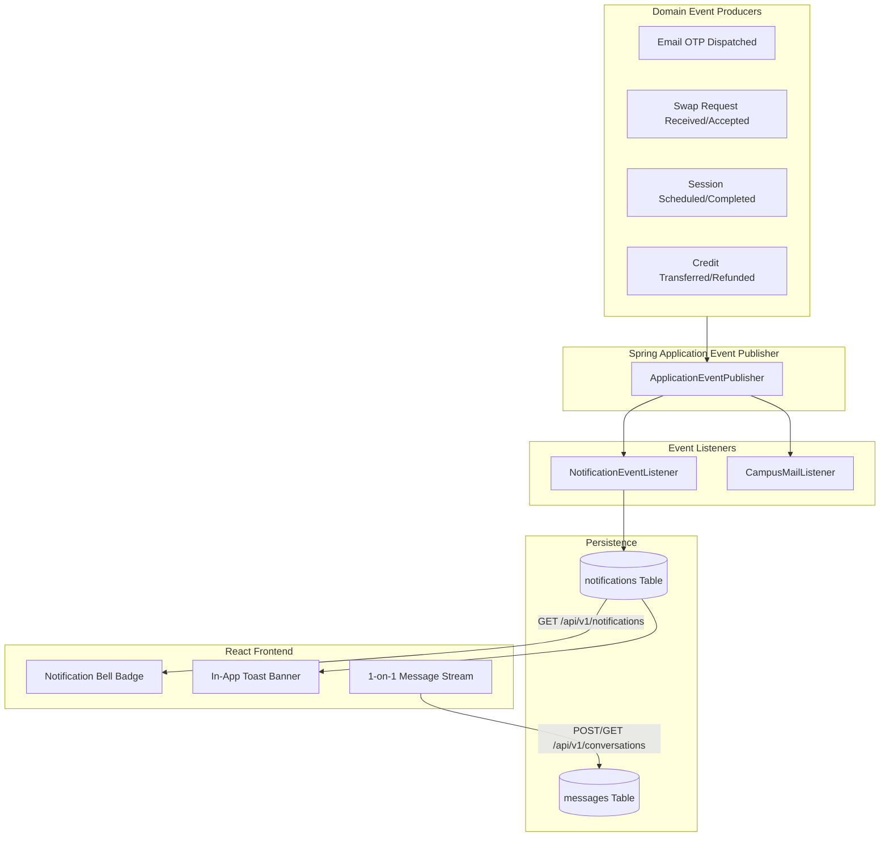

# SkillSwap — Notification & In-App Chat System Specification

```
==========================================================================
Document ID      : COMM-SKILLSWAP-V1
Communication Types: Asynchronous Event Notifications + 1-on-1 Direct Chat
MVP Delivery Mech: RESTful Short-Polling (15s interval) / Event-Driven DB
Future Migration : Spring WebSocket + STOMP Broker
==========================================================================
```

This document details the architecture, data schemas, event taxonomies, polling mechanics, and campus safety rules governing notifications and peer-to-peer messaging.

---

## 1. System Communication Architecture

SkillSwap uses a decoupled event-driven communication model:



---

## 2. Notification Event Taxonomy

The system emits 10 standardized notification events:

| Event Identifier | Trigger Condition | Recipient | Action Link (`action_url`) |
| :--- | :--- | :--- | :--- |
| `SWAP_REQUEST_RECEIVED` | Student submits a new swap request. | Receiver | `/swaps?tab=incoming` |
| `SWAP_REQUEST_ACCEPTED` | Recipient accepts swap proposal. | Sender | `/sessions/schedule/{swapId}` |
| `SWAP_REQUEST_REJECTED` | Recipient declines proposal. | Sender | `/swaps?tab=outgoing` |
| `SESSION_BOOKED` | Session time & venue locked. | Both Students | `/sessions/{sessionId}` |
| `SESSION_REMINDER_1HR` | 60 minutes before scheduled start. | Both Students | `/sessions/{sessionId}` |
| `SESSION_COMPLETED` | Valid 6-digit code verified. | Both Students | `/sessions/{sessionId}/review` |
| `CREDIT_ESCROW_LOCKED` | 1 credit held for session. | Learner | `/wallet` |
| `CREDIT_EARNED` | 1 credit deposited to wallet. | Teacher | `/wallet` |
| `CREDIT_REFUNDED` | Escrow returned upon cancel. | Learner | `/wallet` |
| `DISPUTE_OPENED` | Issue reported on session. | Both + Admin | `/admin/disputes/{reportId}` |

---

## 3. 1-on-1 In-App Direct Messaging

### 3.1 Gated Messaging Policy (Anti-Spam / Anti-Harassment)
To protect students from unsolicited spam or harassment:
- A direct conversation is created **only after a swap request is accepted** or when two students share a mutual match score >= 70%.
- Arbitrary unlinked students cannot message each other.
- If a user is reported or suspended, the chat thread is immediately locked to read-only.

### 3.2 Message Polling vs. WebSocket Migration
- **MVP Implementation**: Lightweight HTTP short-polling via Axios every 10 seconds when the chat modal is active. This avoids server WebSocket connection exhaustion during college project evaluation.
- **Phase 2 Migration**: Spring WebSocket (`@EnableWebSocketMessageBroker`) with SockJS fallback and STOMP message protocol for sub-second delivery.

### 3.3 Data Contracts
- `Conversation`: Links two participant IDs and references the parent `swap_request_id`.
- `Message`:
  ```json
  {
    "id": 501,
    "conversationId": 12,
    "senderId": 101,
    "senderName": "Rohan Sharma",
    "content": "Hey Ananya! I am at the 2nd floor library table near the window.",
    "isRead": false,
    "createdAt": "2026-09-22T15:58:00Z"
  }
  ```

---

## 4. Safety, Moderation & Content Guidelines

1. **Length Restrictions**: Messages are capped at 1,000 characters to prevent buffer exhaustion.
2. **File Attachments**: File/image uploads are disabled in chat for MVP to eliminate malware risk and storage overhead. Students share public GitHub/Figma links for lesson materials.
3. **Audit Trail**: Chat logs are retained in the database to allow campus administrators to adjudicate dispute or harassment reports accurately.
