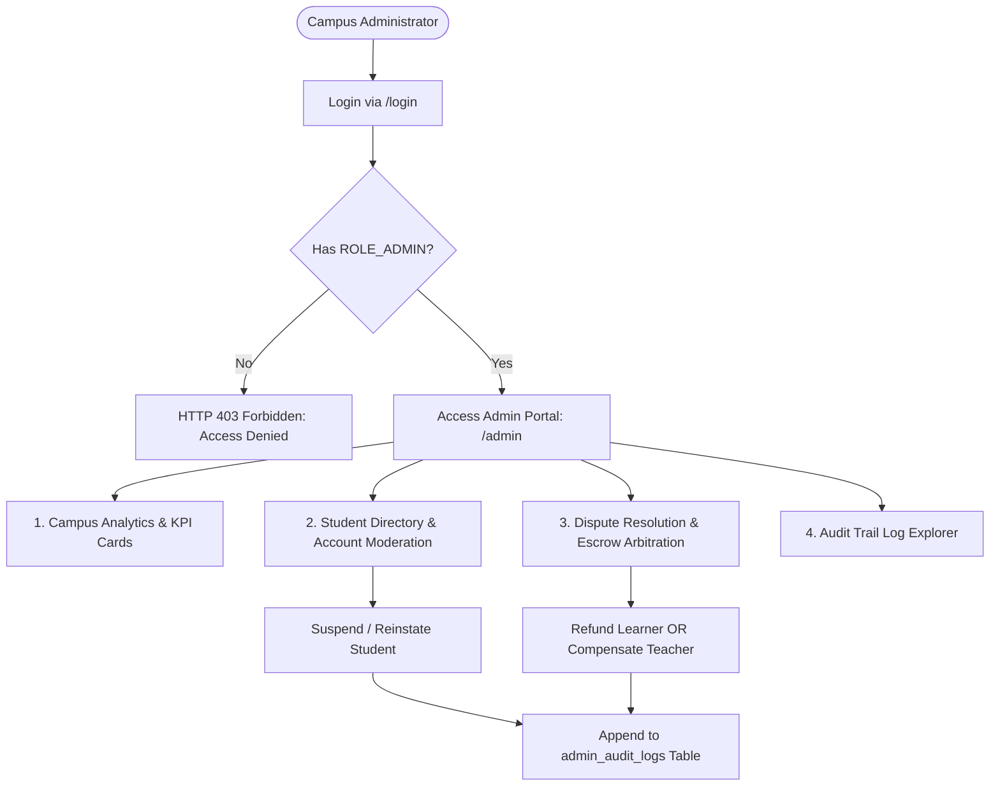

# SkillSwap — Administrator Dashboard & Analytics Specification

```
==========================================================================
Document ID      : ADMN-SKILLSWAP-V1
Authorization    : Strict RBAC (ROLE_ADMIN Only)
Audit Protocol   : Immutable Append-Only Audit Logging (admin_audit_logs)
Analytics Engine : Real-Time SQL Aggregations & Ratios
==========================================================================
```

This document specifies the administrative controls, student conduct moderation, dispute arbitration workflows, audit logging, and campus skill demand-supply analytics.

---

## 1. Administrative Architecture & Role Guarding

The SkillSwap administration console provides campus coordinators and faculty evaluators with complete operational oversight.



---

## 2. Core Administrative Capabilities

### 2.1 Student Account Moderation
- **Search & Filter**: Search students by name, email, department, or account status (`ACTIVE`, `UNVERIFIED`, `SUSPENDED`).
- **Account Suspension**: Temporarily or permanently ban bad actors. A suspended account:
  - Immediately revokes JWT access.
  - Automatically cancels all pending swap requests.
  - Automatically freezes any pending scheduled sessions for administrative arbitration.
  - Hides the student from public searches and match recommendations.
- **Manual Credit Adjustments**: Under exceptional circumstances (e.g., system error during a session), an admin can credit or debit a student wallet. A mandatory `justification_note` is required.

### 2.2 Dispute Arbitration & Escrow Resolution
When a session is marked `DISPUTED` due to a no-show or technical failure:
1. Admin views the dispute ticket containing:
   - Learner identity and statement.
   - Teacher identity and statement.
   - Chat log history between the participants.
   - Scheduled time vs. attempted verification timestamps.
2. Admin selects one of three binding outcomes:
   - **Outcome A (Teacher No-Show / Fault)**: Full refund of 1 credit from escrow back to learner's available balance. Teacher receives a conduct warning flag.
   - **Outcome B (Learner No-Show / Fault)**: Escrow credit of 1 transferred to teacher's wallet to honor their reserved time.
   - **Outcome C (Neutral / Mutual Tech Failure)**: Full refund of 1 credit back to learner with zero penalties to either party.

---

## 3. Campus Skill Demand & Supply Analytics

SkillSwap provides actionable intelligence on campus educational trends:

```
┌────────────────────────────────────────────────────────────────────────┐
│                     Campus Skill Demand vs. Supply                     │
├──────────────────────┬─────────────┬─────────────┬─────────────────────┤
│ Skill Name           │ Demanded (L)│ Offered (T) │ Balance Status      │
├──────────────────────┼─────────────┼─────────────┼─────────────────────┤
│ React.js             │ 48 Students │ 12 Students │ DEFICIT (-36)       │
│ Data Structures (DSA)│ 52 Students │ 38 Students │ BALANCED (-14)      │
│ Figma / UI-UX        │ 35 Students │ 9 Students  │ SEVERE DEFICIT (-26)│
│ Java Programming     │ 22 Students │ 41 Students │ SURPLUS (+19)       │
│ Python Basics        │ 31 Students │ 45 Students │ SURPLUS (+14)       │
│ French Conversation  │ 18 Students │ 3 Students  │ SEVERE DEFICIT (-15)│
└──────────────────────┴─────────────┴─────────────┴─────────────────────┘
```

### 3.1 Key Metric Formulas
- **Skill Deficit Score**: $\text{Deficit} = \text{Count}(\text{Learn Requests}) - \text{Count}(\text{Taught Skills})$.
- **Exchange Completion Rate**: $\frac{\text{Completed Sessions}}{\text{Scheduled Sessions}} \times 100$.
- **Campus Credit Velocity**: Total credits transacted in the last 30 days divided by total active verified users.

---

## 4. Immutable Administrative Audit Logging

Every single administrative override is permanently recorded in `admin_audit_logs`. The database schema forbids modification of these records:

```json
{
  "id": 84,
  "adminUserId": 1,
  "adminEmail": "admin@college.edu",
  "actionType": "RESOLVE_DISPUTE",
  "targetEntity": "SESSION",
  "targetId": 88,
  "actionDetails": "Refunded 1 credit to learner (id: 101) after verifying teacher no-show in chat logs.",
  "ipAddress": "192.168.1.45",
  "createdAt": "2026-09-22T17:30:00Z"
}
```
