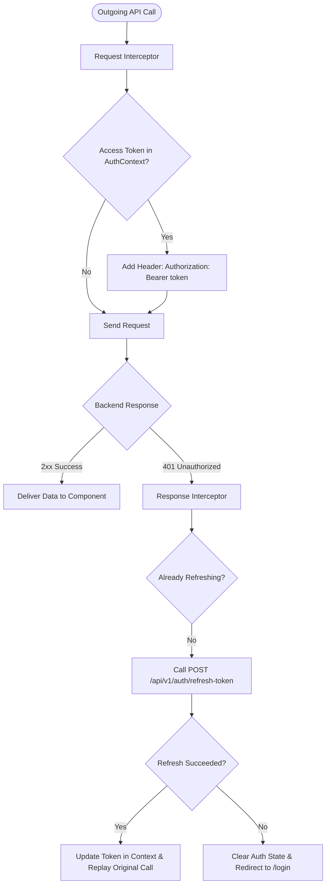
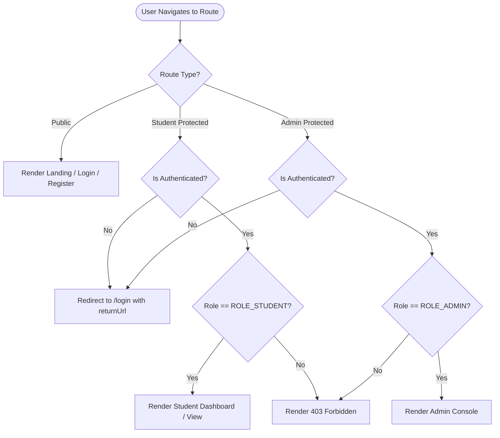

# SkillSwap — Frontend Architecture Specification

```
==========================================================================
Document ID      : FARCH-SKILLSWAP-V1
Technology Stack : React 18 + Vite + Tailwind CSS + React Router v6
HTTP Client      : Axios (Instance Interceptors for JWT & Refresh)
State Management : React Context API + Custom Domain Hooks
Directory Pattern: Modular Feature-Based Folder Structure
==========================================================================
```

This document specifies the client-side architecture, project organization, state management paradigms, API communication pipelines, and route guards for the SkillSwap frontend application.

---

## 1. Directory Structure

```
skillswap-frontend/
├── public/
│   ├── favicon.ico
│   └── avatars/
├── src/
│   ├── api/
│   │   ├── axiosClient.js          # Configured Axios instance with interceptors
│   │   ├── authApi.js              # Login, register, verify OTP, refresh
│   │   ├── profileApi.js           # Student profile, teach/learn skills
│   │   ├── matchApi.js             # Matches & explanations
│   │   ├── swapApi.js              # Swap proposals & lifecycle actions
│   │   ├── sessionApi.js           # Scheduling, verification codes, completion
│   │   ├── walletApi.js            # Balances, transactions
│   │   ├── reviewApi.js            # Post-session review submission
│   │   ├── chatApi.js              # Conversations & message threads
│   │   ├── notificationApi.js      # Notifications & unread counts
│   │   └── adminApi.js             # User moderation, reports, analytics
│   ├── components/
│   │   ├── common/                 # Atoms: Button, Input, Modal, Badge, Spinner
│   │   ├── layout/                 # Shell: Navbar, Sidebar, Footer, PageContainer
│   │   ├── cards/                  # Domain cards: StudentCard, MatchCard, SessionCard
│   │   ├── feedback/               # Toast, SkeletonShimmer, EmptyState, ErrorAlert
│   │   └── forms/                  # Reusable form elements & validation helpers
│   ├── context/
│   │   ├── AuthContext.jsx         # User session, JWT tokens, login/logout actions
│   │   ├── ToastContext.jsx        # App-wide notification toasts
│   │   └── WalletContext.jsx       # Real-time credit balance & sync
│   ├── hooks/
│   │   ├── useAuth.js              # Custom hook for AuthContext
│   │   ├── useWallet.js            # Custom hook for wallet balance
│   │   ├── useDebounce.js          # Search input debouncing
│   │   └── usePolling.js           # Periodic data polling for chat/notifications
│   ├── pages/
│   │   ├── public/                 # LandingPage, LoginPage, RegisterPage, VerifyOtpPage
│   │   ├── student/                # DashboardPage, DiscoverPage, MatchDetailPage,
│   │   │                           # MySkillsPage, AvailabilityPage, SwapsPage,
│   │   │                           # SessionsPage, WalletPage, MessagesPage,
│   │   │                           # ProfilePage, SettingsPage
│   │   └── admin/                  # AdminDashboardPage, AdminReportsPage, AdminUsersPage
│   ├── routes/
│   │   ├── AppRoutes.jsx           # Main React Router v6 definition
│   │   ├── ProtectedRoute.jsx      # Guard enforcing authentication & ROLE_STUDENT
│   │   └── AdminRoute.jsx          # Guard enforcing ROLE_ADMIN
│   ├── utils/
│   │   ├── constants.js            # Enums, categories, API base URLs
│   │   ├── formatters.js           # Date/time formatting, score percentages
│   │   └── validators.js           # Client-side validation regexes
│   ├── App.jsx                     # Root application wrapper
│   ├── index.css                   # Tailwind CSS directives
│   └── main.jsx                    # Vite entry point
├── index.html
├── package.json
├── tailwind.config.js
└── vite.config.js
```

---

## 2. Axios Networking & Interceptor Pipeline

To guarantee seamless JWT authentication, token injection, and automatic refresh without manual user intervention:



### 2.1 Implementation Code Architecture (`src/api/axiosClient.js`)
```javascript
import axios from 'axios';

const axiosClient = axios.create({
  baseURL: import.meta.env.VITE_API_BASE_URL || 'http://localhost:8080/api/v1',
  headers: { 'Content-Type': 'application/json' },
  timeout: 10000,
});

axiosClient.interceptors.request.use((config) => {
  const token = localStorage.getItem('skillswap_access_token');
  if (token) {
    config.headers.Authorization = `Bearer ${token}`;
  }
  return config;
});

axiosClient.interceptors.response.use(
  (response) => response.data,
  async (error) => {
    const originalRequest = error.config;
    if (error.response?.status === 401 && !originalRequest._retry) {
      originalRequest._retry = true;
      try {
        const refreshToken = localStorage.getItem('skillswap_refresh_token');
        const res = await axios.post(`${axiosClient.defaults.baseURL}/auth/refresh-token`, { refreshToken });
        const newAccessToken = res.data.data.accessToken;
        localStorage.setItem('skillswap_access_token', newAccessToken);
        originalRequest.headers.Authorization = `Bearer ${newAccessToken}`;
        return axiosClient(originalRequest);
      } catch (refreshErr) {
        localStorage.clear();
        window.location.href = '/login?sessionExpired=true';
        return Promise.reject(refreshErr);
      }
    }
    return Promise.reject(error.response?.data || error);
  }
);

export default axiosClient;
```

---

## 3. Client-Side State Management

### 3.1 Authentication Context (`AuthContext`)
- Stores: `currentUser`, `isAuthenticated`, `role`, `loading`.
- Actions: `login(email, password)`, `register(data)`, `verifyOtp(email, otp)`, `logout()`.

### 3.2 Wallet Context (`WalletContext`)
- Stores: `availableCredits`, `escrowCredits`, `lastUpdated`.
- Actions: `refreshBalance()`. Automatically triggered when a swap is booked or a session is completed.

---

## 4. Route Protection Architecture


