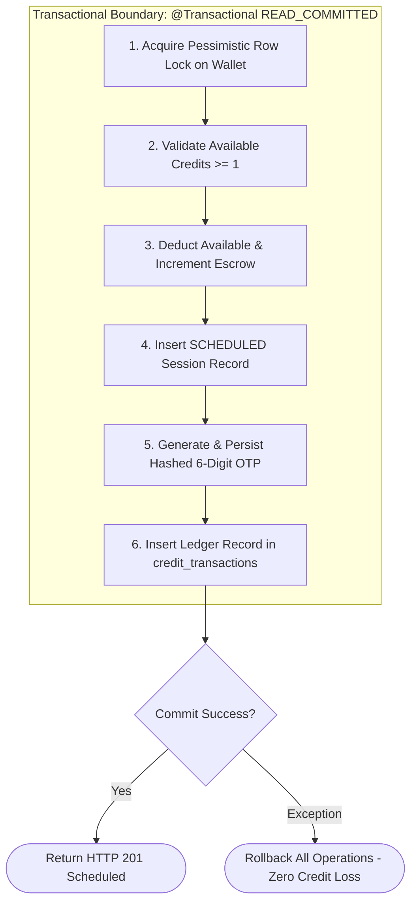

# SkillSwap — Backend Architecture Specification

```
==========================================================================
Document ID      : BARCH-SKILLSWAP-V1
Framework        : Spring Boot 3.5.x (Java 25 LTS)
Persistence      : Spring Data JPA + Hibernate ORM (MySQL 8.0)
Security Layer   : Spring Security 6.2 (Stateless JWT + BCrypt)
Transaction Boundary: Spring @Transactional (Isolation.READ_COMMITTED)
==========================================================================
```

This document specifies the enterprise package topology, service boundary contracts, transaction boundaries, domain exception models, and data validation architecture of the SkillSwap backend.

---

## 1. Enterprise Package Structure

```
com.skillswap
├── SkillSwapApplication.java               # Spring Boot main entry point
├── config/
│   ├── SecurityConfig.java                 # Spring Security 6 filter chain & RBAC
│   ├── JwtConfig.java                      # JWT secret, claims, and parser beans
│   ├── CorsConfig.java                     # Cross-Origin resource sharing whitelist
│   └── WebMvcConfig.java                   # Interceptors, argument resolvers, Jackson
├── controller/
│   ├── AuthController.java                 # /api/v1/auth/**
│   ├── ProfileController.java              # /api/v1/profiles/**
│   ├── SkillController.java                # /api/v1/skills/**
│   ├── MatchController.java                # /api/v1/matches/**
│   ├── SwapRequestController.java          # /api/v1/swaps/**
│   ├── SessionController.java              # /api/v1/sessions/**
│   ├── WalletController.java               # /api/v1/wallet/**
│   ├── ReviewController.java               # /api/v1/reviews/**
│   ├── ChatController.java                 # /api/v1/conversations/**
│   ├── NotificationController.java         # /api/v1/notifications/**
│   └── AdminController.java                # /api/v1/admin/**
├── dto/
│   ├── request/                            # Inbound request payloads
│   │   ├── RegisterRequest.java
│   │   ├── LoginRequest.java
│   │   ├── VerifyOtpRequest.java
│   │   ├── UpdateProfileRequest.java
│   │   ├── CreateSwapProposalRequest.java
│   │   ├── ScheduleSessionRequest.java
│   │   ├── CompleteSessionRequest.java
│   │   └── SubmitReviewRequest.java
│   └── response/                           # Outbound sanitized payloads
│       ├── ApiResponse.java                # Global success envelope
│       ├── ApiErrorResponse.java           # Global RFC 7807 error envelope
│       ├── AuthResponse.java
│       ├── StudentProfileDto.java
│       ├── MatchScoreDto.java
│       ├── SessionSummaryDto.java
│       └── WalletSummaryDto.java
├── entity/
│   ├── User.java
│   ├── StudentProfile.java
│   ├── Department.java
│   ├── SkillCategory.java
│   ├── Skill.java
│   ├── UserTeachSkill.java
│   ├── UserLearnSkill.java
│   ├── Availability.java
│   ├── SwapRequest.java
│   ├── Session.java
│   ├── SessionVerificationCode.java
│   ├── CreditWallet.java
│   ├── CreditTransaction.java
│   ├── Review.java
│   ├── Conversation.java
│   ├── Message.java
│   ├── Notification.java
│   ├── Report.java
│   └── AdminAuditLog.java
├── exception/
│   ├── GlobalExceptionHandler.java         # @RestControllerAdvice
│   ├── ResourceNotFoundException.java
│   ├── InsufficientCreditsException.java
│   ├── InvalidVerificationCodeException.java
│   ├── InvalidSwapStateException.java
│   ├── DuplicateResourceException.java
│   └── UnauthorizedActionException.java
├── repository/
│   ├── UserRepository.java
│   ├── StudentProfileRepository.java
│   ├── SkillRepository.java
│   ├── UserTeachSkillRepository.java
│   ├── UserLearnSkillRepository.java
│   ├── AvailabilityRepository.java
│   ├── SwapRequestRepository.java
│   ├── SessionRepository.java
│   ├── CreditWalletRepository.java
│   ├── CreditTransactionRepository.java
│   ├── ReviewRepository.java
│   └── AdminAuditLogRepository.java
├── security/
│   ├── JwtAuthenticationFilter.java        # Per-request Bearer token extractor
│   ├── JwtTokenProvider.java               # Token generation, signature & validation
│   ├── UserDetailsServiceImpl.java         # Loads student details from database
│   └── CustomAccessDeniedHandler.java
└── service/
    ├── AuthService.java                    # Registration, OTP, token generation
    ├── ProfileService.java                 # Profile mutations & teach/learn inventory
    ├── MatchingEngineService.java          # 100-pt algorithm & score breakdown
    ├── SwapRequestService.java             # Proposal state machine & validation
    ├── SessionLifecycleService.java        # Scheduling, OTP verification & settlement
    ├── CreditWalletService.java            # Atomic escrow hold, transfer & refund
    ├── ReviewService.java                  # Post-session ratings & profile score update
    ├── ChatService.java                    # Direct messages & thread retrieval
    ├── NotificationService.java            # Event listener & in-app alerts
    └── AdminService.java                   # User moderation, dispute arbitration & audit
```

---

## 2. Transaction Boundaries & Concurrency Isolation

SkillSwap enforces database transaction boundaries at the **Service Layer**:



### 2.1 Isolation Level Justification
- `Isolation.READ_COMMITTED` is selected as the optimal enterprise baseline for MySQL InnoDB.
- Prevents dirty reads without the heavy locking performance penalty of `SERIALIZABLE`.
- Coupled with explicit `SELECT ... FOR UPDATE` (Pessimistic Locking) on the `credit_wallets` table, this guarantees complete isolation against race conditions and phantom updates during simultaneous credit operations.

---

## 3. Global Exception Handling & Validation Pipeline

### 3.1 Validation Pipeline
Incoming requests undergo automated Bean Validation before hitting business logic:
```java
public class ScheduleSessionRequest {
    @NotNull(message = "Swap request ID is required.")
    private Long swapRequestId;

    @NotNull(message = "Scheduled date is required.")
    @FutureOrPresent(message = "Session date cannot be in the past.")
    private LocalDate scheduledDate;

    @NotNull(message = "Start time is required.")
    private LocalTime startTime;

    @NotBlank(message = "Meeting venue or link must be provided.")
    @Size(max = 255, message = "Venue description cannot exceed 255 characters.")
    private String venueOrLink;
}
```

### 3.2 Global Exception Handler (`GlobalExceptionHandler.java`)
```java
@RestControllerAdvice
public class GlobalExceptionHandler {

    @ExceptionHandler(MethodArgumentNotValidException.class)
    public ResponseEntity<ApiErrorResponse> handleValidationErrors(MethodArgumentNotValidException ex) {
        List<FieldErrorItem> errors = ex.getBindingResult().getFieldErrors().stream()
            .map(err -> new FieldErrorItem(err.getField(), err.getRejectedValue(), err.getDefaultMessage()))
            .collect(Collectors.toList());

        ApiErrorResponse response = new ApiErrorResponse(
            false, "VALIDATION_FAILED", "Request contains invalid inputs.", errors, Instant.now()
        );
        return ResponseEntity.status(HttpStatus.BAD_REQUEST).body(response);
    }

    @ExceptionHandler(InsufficientCreditsException.class)
    public ResponseEntity<ApiErrorResponse> handleInsufficientCredits(InsufficientCreditsException ex) {
        ApiErrorResponse response = new ApiErrorResponse(
            false, "INSUFFICIENT_CREDITS", ex.getMessage(), null, Instant.now()
        );
        return ResponseEntity.status(HttpStatus.PAYMENT_REQUIRED).body(response);
    }

    @ExceptionHandler(ResourceNotFoundException.class)
    public ResponseEntity<ApiErrorResponse> handleNotFound(ResourceNotFoundException ex) {
        ApiErrorResponse response = new ApiErrorResponse(
            false, "NOT_FOUND", ex.getMessage(), null, Instant.now()
        );
        return ResponseEntity.status(HttpStatus.NOT_FOUND).body(response);
    }
}
```
