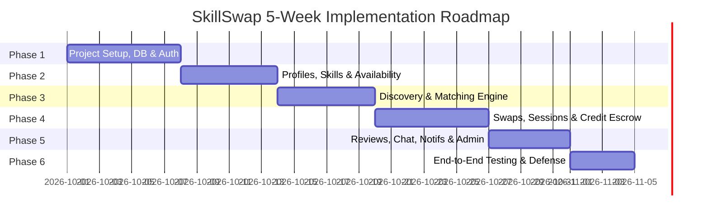

# SkillSwap — Incremental Development Roadmap

```
==========================================================================
Document ID      : ROADMAP-SKILLSWAP-V1
Execution Model  : 6 Incremental Iterations / Agile Sprint Cadence
Total Duration   : 5 Weeks (College Minor Project Timeline)
Milestone Focus  : Working Software at Each Iteration Gate
==========================================================================
```

This document specifies the chronological development sequence, sprint tasks, inter-module dependencies, deliverable outputs, and strict Definitions of Done (DoD) for building SkillSwap.

---

## 1. Roadmap Master Timeline Overview



---

## 2. Iteration Phase Details

### Phase 1: Foundation, Database & Authentication (Days 1–7)
- **Objective**: Establish development environments, MySQL schema, and secure JWT authentication.
- **Tasks**:
  1. Initialize Spring Boot 3 and React Vite repositories.
  2. Setup MySQL 8.0 and configure Spring Data JPA entities (`User`, `Department`, `CreditWallet`).
  3. Implement BCrypt password hashing and JWT token provider.
  4. Build `/api/v1/auth/register` with college email regex whitelist.
  5. Build `/api/v1/auth/verify-email` with 6-digit numeric OTP generation.
  6. Build `/api/v1/auth/login` and refresh token endpoint.
  7. Build React auth pages: Login, Register, OTP verification modal.
- **Dependencies**: None.
- **Deliverables**: Working login/registration flow issuing JWTs and creating activated user records with 3 welcome credits.
- **Definition of Done (DoD)**:
  - Unit tests for password hashing and JWT generation pass.
  - User cannot register with non-college email domain.
  - Verified user account receives initial wallet balance of 3 credits.

---

### Phase 2: Profiles, Skills & Availability (Days 8–13)
- **Objective**: Allow students to set up academic profiles, teaching inventories, learning goals, and free time slots.
- **Tasks**:
  1. Implement JPA entities: `StudentProfile`, `SkillCategory`, `Skill`, `UserTeachSkill`, `UserLearnSkill`, `Availability`.
  2. Seed default categories (Programming, Design, Languages, Academics) and 30 popular campus skills.
  3. Build profile endpoints: `GET/PUT /api/v1/profiles/me`.
  4. Build teach/learn skill management endpoints.
  5. Build weekly availability scheduler endpoint (`PUT /api/v1/profiles/me/availability`).
  6. Implement React pages: Onboarding Wizard, My Skills manager, Availability scheduler grid.
- **Dependencies**: Phase 1 (Authenticated student identity).
- **Deliverables**: Complete student profile management UI and data layer.
- **Definition of Done (DoD)**:
  - Student can add up to 10 taught skills and 10 learning goals.
  - End time is strictly after start time in availability slots.
  - Availability grid renders correctly on mobile and desktop.

---

### Phase 3: Discovery & Matching Engine (Days 14–19)
- **Objective**: Implement student directory search and the 100-point deterministic matching engine.
- **Tasks**:
  1. Implement JPA Specification search query for `/api/v1/students` with keyword, category, proficiency, and day filters.
  2. Develop `MatchingEngineService` implementing the 5-factor scoring formula (Mutual match, Proficiency, Availability, Rating, Mode/Proximity).
  3. Build `/api/v1/matches` returning ranked candidates scoring >= 30 points.
  4. Build `/api/v1/matches/{targetId}/explanation` returning itemized score breakdown.
  5. Build React Discover page and Match Detail explanation modal.
- **Dependencies**: Phase 2 (Profile, skill, and availability data populated).
- **Deliverables**: Functional search catalog and explainable match recommendation UI.
- **Definition of Done (DoD)**:
  - Unit tests verify 100% score for exact mutual swaps.
  - Match explanation component displays points breakdown matching total score.
  - Search query responds in < 250ms with 100 mock profiles.

---

### Phase 4: Swaps, Sessions & Skill Credit Escrow (Days 20–26)
- **Objective**: Build the core peer exchange engine: swap proposals, calendar scheduling, escrow holds, and 6-digit OTP verification.
- **Tasks**:
  1. Implement `SwapRequest` entity, state machine, and `/api/v1/swaps` endpoints.
  2. Implement `CreditWalletService` with pessimistic locking (`PESSIMISTIC_WRITE`) for atomic balance movements.
  3. Implement `Session` scheduling with automatic escrow lock (-1 available, +1 escrow).
  4. Build 6-digit mutual session verification code generation and validation.
  5. Build `/api/v1/sessions/{id}/complete` transferring escrow credit to teacher.
  6. Build `/api/v1/sessions/{id}/cancel` with 2-hour refund policy.
  7. Build React Swaps manager, Session hub, and Wallet ledger pages.
- **Dependencies**: Phase 1 (Wallets) & Phase 3 (Matched student pairs).
- **Deliverables**: Complete end-to-end peer tutoring workflow from booking to credit settlement.
- **Definition of Done (DoD)**:
  - Double-spending concurrency test passes without negative balance.
  - Student cannot propose swap to themselves.
  - 6-digit code unlocks credit transfer exactly once.

---

### Phase 5: Reviews, Chat, Notifications & Admin (Days 27–31)
- **Objective**: Deliver accountability, in-app communication, and campus moderation tools.
- **Tasks**:
  1. Build `Review` entity and endpoint `POST /api/v1/sessions/{id}/reviews`.
  2. Implement average rating and endorsement calculations on student profiles.
  3. Implement in-app REST-polled 1-on-1 chat (`/api/v1/conversations/**`).
  4. Implement notification listener dispatching alerts for swaps, bookings, and completions.
  5. Implement student reporting (`POST /api/v1/reports`).
  6. Implement Admin Console (`/admin`): Dispute arbitration, user suspension, skill analytics.
  7. Build React chat pane, notification center, and admin dashboard views.
- **Dependencies**: Phase 4 (Completed sessions exist to review).
- **Deliverables**: Complete community safety, moderation, and communication suite.
- **Definition of Done (DoD)**:
  - Review cannot be submitted for uncompleted sessions.
  - Non-admin users receiving HTTP 403 when hitting `/admin/**`.
  - Admin dispute resolution correctly triggers escrow settlement or refund.

---

### Phase 6: Testing, Polish & Defense Preparation (Days 32–35)
- **Objective**: System-wide end-to-end testing, visual polish, and academic viva preparation.
- **Tasks**:
  1. Run complete automated test suite (Unit, Integration, Security).
  2. Seed realistic campus demonstration dataset (25 students across 4 departments).
  3. Polish empty states, error toasts, and mobile responsive breakpoints.
  4. Compile final College Project Report (`docs/22_COLLEGE_PROJECT_REPORT.md`).
  5. Rehearse live demonstration scenario.
- **Deliverables**: Production-ready college minor project with documentation and demo script.
- **Definition of Done (DoD)**: Zero unhandled console errors; all 22 features demonstrated live.
