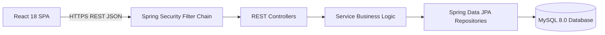

# SkillSwap: A Peer-to-Peer College Skill Exchange Platform with Skill Credit Economics

```
==========================================================================
ACADEMIC MINOR PROJECT DISSERTATION & TECHNICAL REPORT
Department of Computer Science & Engineering
Title: Design and Implementation of a Cashless Peer-to-Peer Skill
       Exchange Platform for Higher Education Institutions
Authors: Undergraduate Project Team
Platform Name: SkillSwap (Learn. Teach. Exchange.)
Target Evaluation: Minor Project Defense / University Examination
==========================================================================
```

---

## Abstract

Higher education campuses host an immense, untapped repository of decentralized skills distributed across academic disciplines. However, traditional barriers—such as the financial cost of professional tutoring, departmental isolation, and the unreliability of informal messaging groups—prevent effective peer knowledge transfer.

This project presents **SkillSwap**, an enterprise-grade, peer-to-peer web application engineered to democratize campus learning through a cashless **Skill Credit System**. Built using React, Vite, Spring Boot 3, and MySQL, SkillSwap enables students to teach subjects they have mastered in exchange for credits, which are subsequently redeemed to learn new skills from fellow students. 

To eliminate fraud, double-spending, and scheduling friction, the platform incorporates:
1. An institutional email domain verification firewall,
2. An explainable, 100-point deterministic multi-criteria matching engine,
3. An atomic credit escrow model using database row-level locking, and
4. A mutual 6-digit session verification protocol.

This report documents the end-to-end design, architectural specifications, database schema, algorithms, verification methodologies, and formal conclusions of the SkillSwap system.

---

## Chapter 1: Introduction & Motivation

### 1.1 Background
The rapid pace of modern software development, design methodologies, and multidisciplinary education requires university students to continuously acquire complementary skills outside their prescribed syllabus. While online platforms (MOOCs) provide recorded lectures, they lack the interactive debugging, immediate feedback, and personal accountability provided by 1-on-1 human mentorship.

### 1.2 Motivation
Within a single university campus, senior students and departmental peers frequently possess the exact skills sought by junior or cross-faculty classmates. However, students lack a structured platform where this exchange can occur without commercial transactions. SkillSwap was conceived to transform college campuses into self-sustaining, cashless collaborative learning communities.

---

## Chapter 2: Problem Statement & Existing Systems Analysis

### 2.1 Problem Definition
Informal knowledge sharing on campus suffers from three fundamental structural weaknesses:
1. **The Double Coincidence of Wants**: In traditional barter, Student A can only learn from Student B if Student B simultaneously wants to learn what Student A teaches.
2. **High Friction & Flakiness**: Informal arrangements on messaging apps suffer from frequent no-shows, lack of scheduling coordination, and ghosting.
3. **Absence of Accountability**: Tutees cannot assess tutor competence or safety beforehand, and tutors receive no structured recognition for their volunteer time.

### 2.2 Comparative Analysis with Existing Systems

| Dimension | Commercial Tutoring (Wyzant, Chegg) | Informal Groups (WhatsApp, Discord) | SkillSwap (Proposed System) |
| :--- | :--- | :--- | :--- |
| **Financial Cost** | High ($25–$80/hr) | Zero | **Zero (Credit-Based Barter)** |
| **Trust Model** | Unvetted strangers | Campus peers, but no verification | **Campus Email Domain Verified** |
| **Matching** | Search filter only | Manual text broadcast | **100-Point Algorithmic Matching** |
| **Scheduling** | Third-party calendar | Ad-hoc text chat | **Interactive Availability Grid** |
| **Fraud Defense** | Credit card chargebacks | None | **Atomic Escrow + 6-Digit OTP** |

---

## Chapter 3: Proposed System Architecture

### 3.1 Architectural Overview
SkillSwap adopts a decoupled 3-tier enterprise architecture:
- **Presentation Layer**: Single-Page Application (SPA) developed with React 18, Vite, and Tailwind CSS.
- **Application Layer**: Monolithic Spring Boot 3 application structured into Controllers, DTOs, Services, Repositories, and Security Filters.
- **Persistence Layer**: Relational MySQL 8.0 engine enforcing referential integrity and ACID transactional consistency.



---

## Chapter 4: Core Algorithmic & Economic Models

### 4.1 The Skill Credit Economics & Escrow Model
- **Token Unit**: 1 Skill Credit = 1 Hour (60 minutes) of verified instruction.
- **Signup Incentive**: 3 Skill Credits awarded upon verifying campus email.
- **Escrow Invariant**: When a session is booked, 1 credit is moved from `available_balance` to `escrow_balance`.
- **Atomic Settlement**: Credit moves from learner's escrow to teacher's wallet only when the teacher submits the valid 6-digit OTP provided by the learner at the session.

### 4.2 Deterministic 100-Point Matching Engine
Compatibility between Learner $L$ and Teacher $T$ is computed using a deterministic weighted scoring formula:

$$\text{Score}(L, T) = S_{\text{mutual}} (40) + S_{\text{proficiency}} (20) + S_{\text{availability}} (20) + S_{\text{reputation}} (10) + S_{\text{proximity}} (10)$$

Where:
- $S_{\text{mutual}} = 40$ for direct two-way barter, $20$ for one-way credit swap.
- $S_{\text{proficiency}}$ matches tutor qualification to learner target tier.
- $S_{\text{availability}}$ awards points proportional to overlapping weekly 1-hour slots.
- $S_{\text{reputation}}$ scales tutor's average rating ($R \times 2.0$).
- $S_{\text{proximity}}$ scores learning mode (`IN_PERSON` vs `ONLINE`) and department affinity.

---

## Chapter 5: Relational Database Design

The system implements a 3NF normalized schema spanning 18 relational tables:
- **Identity & Profiles**: `users`, `departments`, `student_profiles`.
- **Taxonomy & Skills**: `skill_categories`, `skills`, `user_teach_skills`, `user_learn_skills`.
- **Calendar**: `availabilities`.
- **Exchange & Verification**: `swap_requests`, `sessions`, `session_verification_codes`.
- **Ledger**: `credit_wallets`, `credit_transactions`.
- **Social & Safety**: `reviews`, `conversations`, `messages`, `notifications`, `reports`, `admin_audit_logs`.

Refer to [`docs/07_DATABASE_DESIGN.md`](./07_DATABASE_DESIGN.md) for full column-level schemas, primary keys, foreign keys, and indexes.

---

## Chapter 6: Functional Modules

1. **Authentication & Campus Verification Module**: Whitelisted domain regex matching, BCrypt hashing, JWT issuance, and 6-digit email OTP validation.
2. **Profile & Skill Inventory Module**: Multi-level skill declaration, proficiency tagging (Beginner to Expert), and recurring weekly availability grid.
3. **Matching & Discovery Module**: High-performance multi-attribute catalog search and transparent match explanation generation.
4. **Swap Negotiation & Session Module**: Proposal state machine (`PENDING` -> `ACCEPTED` -> `SCHEDULED` -> `COMPLETED`), venue coordination, and escrow locking.
5. **Credit Wallet & Ledger Module**: Row-locked atomic credit operations with immutable double-entry transaction history.
6. **Reviews & Reputation Module**: Dual post-session 5-star ratings and endorsement badges.
7. **In-App Messaging & Notifications Module**: 1-on-1 participant chat and system alert dispatcher.
8. **Administration & Analytics Module**: Student moderation, dispute arbitration, and campus skill demand-supply analytics.

---

## Chapter 7: Verification & Testing Methodology

### 7.1 Testing Regimen
- **Unit Testing**: JUnit 5 and Mockito testing domain services in isolation.
- **Integration Testing**: `@SpringBootTest` with `MockMvc` verifying API contracts, validation annotations, and error response envelopes.
- **Concurrency Testing**: Multi-threaded race condition tests verifying that simultaneous session booking calls cannot double-spend available credits.
- **Security Testing**: Verification that protected endpoints reject requests lacking valid JWT tokens or student/admin roles.

---

## Chapter 8: System Limitations

1. **Single Institution Scope**: The current MVP architecture is bounded to a single university domain.
2. **Asynchronous Video Dependence**: Does not host native video calls within the browser; relies on campus physical venues or Google Meet links.
3. **Short-Polling Communication**: Messaging utilizes lightweight REST polling rather than persistent full-duplex WebSockets.

---

## Chapter 9: Future Enhancements

1. **In-App WebRTC Peer Video**: Browser-to-browser encrypted video calling and interactive whiteboard.
2. **AI Semantic Matching**: Vector embeddings (Google Gemini / OpenAI) for semantic skill matching.
3. **Federated Multi-Campus Architecture**: Tenant isolation allowing inter-university skill exchanges.
4. **Two-Way Google Calendar Synchronization**: Automated scheduling push to personal university calendars.

---

## Chapter 10: Conclusion

SkillSwap demonstrates that higher education institutions can overcome the barriers of expensive commercial tutoring and fragmented social media groups by deploying an accountable, credit-backed peer skill exchange platform. 

By grounding transactions in an immutable credit ledger, protecting commitments with escrow locks, verifying physical attendance via mutual codes, and matching students algorithmically, SkillSwap creates an equitable, campus-wide learning network where every student can teach what they know and learn what they need.

---

## References

1. Gamma, E., Helm, R., Johnson, R., & Vlissides, J. *Design Patterns: Elements of Reusable Object-Oriented Software*. Addison-Wesley, 1994.
2. Fielding, R. T. *Architectural Styles and the Design of Network-based Software Architectures*. Doctoral dissertation, University of California, Irvine, 2000.
3. Walls, C. *Spring in Action, Sixth Edition*. Manning Publications, 2022.
4. OWASP Foundation. *OWASP Top 10: 2021 The Ten Most Critical Web Application Security Risks*. 2021.
5. Cahn, E. S. *No More Throw-Away People: The Co-Production Imperative (Time Dollars & Time Banking)*. Essential Books, 2004.
